## What is LISA with TTLC?

LISA is a Microcontroller built around a custom 8-Bit Little ISA (LISA)
microprocessor core.  It includes several standard peripherals that
would be found on commercial microcontrollers including timers, GPIO,
UARTs, I2C, an SPI master and a WS2812B LED driver. TTLC is a Programmable
Logic Controller for Tiny Tapeout (TTLC) built around a functional equivalent
of a Motorola MC14500B industrial control unit.

The following is a block diagram of the design:

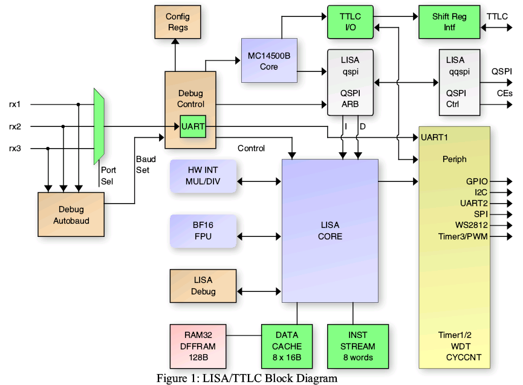

   - The LISA Core has a minimal set of registers that allow it to run C programs:
      - Program Counter (15 bits) + 7-bit Code Bank register
      - Return Address, Stack Pointer and Index Register (23 bits, indexed DATA access)
      - 8-bit Accumulator
      - BF16 floating point accumulator (facc) and four BF16 registers (f0 - f3)
      - Flag bits and ALU mode register
      - Interrupt control bits

### Detailed list of the features
   - 50 MHz clock (20 ns), timing met at every process corner
   - Harvard architecture LISA Core: 16-bit instructions, 128 code banks of 16 K words (4 MB of
     code), a flat 8 MB data space (23-bit addresses)
   - Motorola MC14500B System Controller with PC, Stack, I/O and storage
   - Debug interface
      * UART controlled
      * Auto detects port from one of 3 interfaces
      * Auto detects the baud rate
      * Interfaces with SPI / QSPI SRAM or FLASH
      * Can erase / program the (Q)SPI FLASH
      * Read/write LISA core registers and peripherals
      * Set LISA breakpoints, halt, resume, single step, etc.
      * SPI/QSPI programmability (single/quad, port location, CE selects)
   - (Q)SPI Arbiter with 4 access channels
      * Debug interface for direct memory access
      * Instruction fetch (LISA and MC14500B)
      * Data fetch
      * WS2812 pixel data "DMA" fetch (shared with TTLC instruction)
      * Quad or Single SPI.  Hereafter called QSPI, but supports either.
   - Hardware 8x8 integer multiplier (signed or unsigned)
   - Hardware 16/16 restoring integer divider: quotient and remainder, signed or unsigned, with a
     chained step for dividends of any width
   - Hardware Brain Float 16 (BF16) add / multiply / divide / negate / compare / int-to-float / float-to-int
   - Onboard 128 Byte RAM for DATA / DATA CACHE
   - Data bus CACHE controller with 8 16-byte CACHE lines
   - Streaming QSPI instruction fetch with an 8-word window: sequential code runs at the QSPI word rate
   - Two 16-bit programmable timers (with pre-divide)
   - Six PLC timers (on / off delay, 1 ms to 1 s ticks) and four PLC counters, function blocks in the TTLC's I/O
     space that LISA can use too
   - Two high-speed counters: pulses, pulses with a direction, or quadrature x1 / x4 on any pair of ui_in pins,
     with a compare, a glitch filter and an interrupt
   - Timer 3: a 16-bit timer with two PWM outputs, two input captures and PDM output
   - Debug UART available to LISA core also
   - Dedicated UART2 that is not shared with the debug interface: an 8-byte transmit FIFO, an RS-485 direction
     output and a Modbus RTU frame-idle timer
   - 8-bit Input port (PORTA)
   - 8-bit Output port (PORTB)
   - 4-bit BIDIR port (PORTC)
   - I2C Master controller
   - SPI Master controller (two chip selects, its own pins or shared with the TTLC's)
   - WS2812B NeoPixel LED string driver (when not using TTLC) on up to five pins
   - TTLC 48-Outputs plus 48-Inputs via external 74HC595 / 74HC165 chips
   - TTLC 128-Bit internal storage plus 16 bit I/O to LISA (8 each direction)
   - TTLC I/O readable / writable by LISA as bytes, with LISA-started I/O scans
   - Programmable I/O mux for maximum flexibility of I/O usage.
   - A stack pointer limit fault (an interrupt or a reset) and a sleep instruction

A 32x32 1RW [DFFRAM](https://github.com/AUCOHL/DFFRAM) macro implements a 128 byte RAM module.
The RAM can be used either as a DATA cache for the processor, giving an 8 MB data address range
through the QSPI PSRAM, or the CACHE controller can be disabled, connecting the Lisa processor core
to the RAM directly, limiting the data space to 128 bytes.

## Connectivity

All communication with the design is done through a UART connected to the Debug Controller.  The UART
I/O pins are auto-detected by the debug_autobaud module from the following choices (RX/TX):

    ui_in[3]  / uo_out[4]     RP2040 UART interface   
    uio_in[4] / uio_out[5]    LISA QSPI / UART Pmod (io mux mode 3, see "Programming the QSPI Controller")
    uio_in[6] / uio_out[5]    Standard UART PMOD

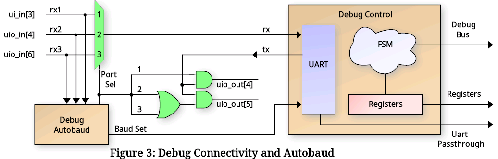

The RX/TX pair port is auto-detected after reset by the autobaud circuit, and the UART baud rate can either be
configured manually or auto detected by the autobaud module.  After reset, the ui_in[7] pin is sampled to determine
the baud rate selection mode.  If this input pin is HIGH, then autobaud is disabled and ui_in[6:0] is sampled as
the UART baud divider and written to the Baud Rate Generator (BRG).  A bit is 32 x (divider + 1) clocks, so the
value of this divider should be: clk_freq / baud_rate / 32 - 1.  At the 50 MHz clock and 115200 baud the nearest
value is 13 (50000000 / 115200 / 32 - 1 = 12.6), a bit of 448 clocks, 3% slow and within a UART's tolerance; the
autobaud below matches the rate exactly.

If the ui_in[7] pin is sampled LOW, then the autobaud module will monitor all three potential RX input pins for a
character that contains three successive pulses of the same width, such as LINEFEED (ASCII 0x0A), and sets the bit
period from that width.  It monitors bit transitions and measures each pulse in clocks: three pulses in a row that
agree to within two clocks set the bit period, which can be any value from 32 clocks up (14 bits, 1.56 Mbaud down to
3052 baud at 50 MHz).  Since ASCII code 0x0A contains a "0 1 0 1 0" bit sequence, the baud rate can be detected easily.

Regardless if the baud rate is set manually or using autobaud, the input port selection will be detect automatically 
by the autobaud.  In the case of manual baud rate selection, it simply looks for the first transition on any of the
three RX pins.  For autobaud, it selects the RX line with three successive equivalent bit periods.

### Debug Interface Details

The Debug interface uses a fixed, Verilog coded Finite State Machine (FSM) that supports a set of commands over
the UART to interface with the microcontroller.  These commands are simple ASCII format such that low-level testing
can be performed using any standard terminal software (such as minicom, tio. Putty, etc.).  The 'r' and 'w' commands must be
terminated using a NEWLINE (0x0A) with an optional CR (0x0D).  Responses from the debug interface are always 
terminated with a LINFEED plus CR sequence (0x0A, 0x0D).  All HEX values must be lower case.

 | Command   | Description                                                          |
 | ------------- | --------------------------------------------------------------- |
 | v         | Report Debugger version.  Should return: lisav2.0                    |
 | wAAVVVV   | Write 16-bit HEX value 'VVVV' to register at 8-bit HEX address 'AA'. |
 | rAA       | Read 16-bit register value from 8-bit HEX address 'AA'.              |
 | t         | Reset the LISA core.                                                 |
 | l         | Grant LISA the UART.  Further data will be ignored by the debugger.  |
 | +++       | Revoke LISA UART.  NOTE: a guard time with no traffic before and after is required: |
 |           | (reg 0x1a x 2^20 + 0xFFFFF) clocks, 42 ms at the reset value 1; 0.5 s is safe. |

### Debug Configuration and Control Registers

The following table describes the configuration and LISA debug register addresses available via the debug 'r' and 'w'
commands.  The individual register details will be described in the sections to follow.

 | ADDR | Description                  | ADDR | Description                  |
 | ---------- | ------------------------------------ | ---------- | ----------------------------------- |
 | 0x00 | LISA Core Run Control        | 0x19 | QSPI Write CMD value         |                                           
 | 0x01 | LISA Accumulator / FLAGS     | 0x1a | The '+++' guard time count   |   
 | 0x02 | LISA Program Counter (PC)    | 0x1b | Mux bits for uo_out          |   
 | 0x03 | LISA Stack Pointer (SP) LSW  | 0x1c | UIO mux, TTLC clk_div, psram_mod |   
 | 0x04 | LISA Return Address (RA) LSW | 0x1d | CACHE control                |   
 | 0x05 | LISA Index Register (IX) LSW | 0x1e | QSPI edge / SCLK speed       |   
 | 0x06 | LISA Data bus                | 0x1f | TTLC (MC14500B) base address |   
 | 0x07 | LISA Data bus address LSW    | 0x20 | Debug QSPI Read / Write      |   
 | 0x08 | LISA Breakpoint 1            | 0x21 | Debug QSPI custom command    |   
 | 0x09 | LISA Breakpoint 2            | 0x22 | Debug read SPI status reg    |   
 | 0x0a | LISA Breakpoint 3            | 0x30 | Floating point reg f0        |   
 | 0x0b | LISA Breakpoint 4            | 0x31 | Floating point reg f1        |   
 | 0x0c | LISA Breakpoint 5            | 0x32 | Floating point reg f2        |   
 | 0x0d | LISA Breakpoint 6            | 0x33 | Floating point reg f3        |   
 | 0x0f | LISA Current Opcode Value    | 0x34 | Floating point reg facc      |     
 | 0x10 | Debug QSPI Address (LSB16)   | 0x38 | LISA IX_COND, IX MSB         |     
 | 0x11 | Debug QSPI Address (MSB8)    | 0x39 | LISA SP MSB                  |     
 | 0x12 | LISA1 QSPI base address      | 0x3a | LISA RA_COND, RA MSB         |     
 | 0x13 | LISA2 QSPI base address      | 0x3c | LISA Data bus addr MSB       |     
 | 0x14 | LISA1 QSPI CE select         | 0x40 | MC14500B Run Control         |     
 | 0x15 | LISA2 and TTLC QSPI CE select | 0x41 | MC14500B Program Counter     |     
 | 0x16 | Debug QSPI CE select         | 0x48 | MC14500B Breakpoint 1        |     
 | 0x17 | QSPI Mode (QUAD, flash, 16b, DDR) | 0x49 | MC14500B Breakpoint 2        |     
 | 0x18 | QSPI Dummy read cycles       | 0x4a | MC14500B Breakpoint 3        |     

Notes on the LISA core registers:

  - 0x00: bit 0 halts the core (write 1) or lets it run (write 0); bits 2:1 resume or single step a
    halted core.  The upper bits read back the core's register widths.
  - 0x01: reads {0, amode[2:0], cond[1:0], C, Z, A[7:0]}.  A write with bit 15 clear loads A from
    bits 7:0; a write with bit 15 set loads amode, cond, C and Z from bits 14:8.
  - 0x03 / 0x39, 0x04 / 0x3a, 0x05 / 0x38, 0x07 / 0x3c: the 23-bit SP, RA, IX and data address are
    read and written as a low word and a high register holding bits 22:16 (with the condition bit
    above them for RA and IX).  A debug data access (0x06) with bit 15 of 0x07 set reads or writes
    the peripheral space instead of data memory.
  - 0x1b: the uo_out function select, two bits per pin ([1:0] uo[0] ... [15:14] uo[7]): 0 the default
    function, 1 Port B, 2 the UART2 / Timer 3 / SPI master set, 3 the TTLC / WS2812B set (see
    "Legend for Pinout").
  - 0x1d: [6] invalidate the TTLC's fetch window, [5] invalidate the instruction window, [4] invalidate
    the data cache, [3] flush the data cache (write dirty lines back), [2] disable the data cache (the
    128-byte RAM is then the data space), [1:0] reserved (read 3).

### LISA Processor Interface Details                                         

The LISA Core requires external memory for all Instructions and Data.  To accommodate external memory,
the design uses a QSPI controller that is configurable as either single SPI or
QUAD SPI, Flash or SRAM access, 16-Bit or 24-Bit addressing, and selectable Chip Enable for each
type of access.  To achieve this, a QSPI arbiter is used to allow multiple accessors as shown in
the following diagram:

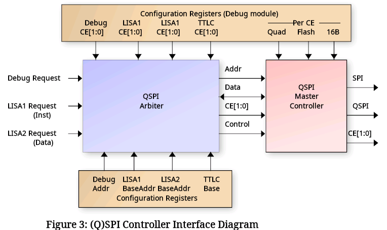

The arbiter is controlled via configuration registers (accessible by the Debug controller)
that specify the operating mode per CE, and CE selection bits for each of the four interfaces:

   - Debug Interface
   - LISA1 (Instruction fetch)
   - LISA2 (Data read/write)
   - TTLC / MC14500B (Instruction fetch, and the WS2812B driver's pixel DMA)

The arbiter gives priority to the Debug accesses and processes the LISA1, LISA2 and TTLC requests
in turn.  Each requestor provides a 24-bit byte address along with 16-bit data read/write.
For the Debug interface, the address comes from the configuration registers directly (0x10 and 0x11).
For LISA1 the address is {LISA1_BASE, 8'h0} OR {CB, PC[13:0], 0}: the code bank and the word address
within it, as a byte address (the instruction space is 4 MB, 22 bits).  For LISA2 it is
{LISA2_BASE, 8'h0} OR the 23-bit data address (8 MB).  For the TTLC it is {TTLC_BASE, 8'h0} OR the
program word address as a byte address (Debug register 0x1F); the WS2812B driver's pixel frames are
read through the LISA2 base.
The LISA1, LISA2 and TTLC base addresses are programmed by the Debug controller (0x12, 0x13, 0x1F) and are ORed
onto the upper 16 bits of the 24-bit address, so a base is normally a multiple of the space it is
set above (0x4000 for a 4 MB code space, 0x8000 for the 8 MB data space).  The BASE addresses allow
use of a single external QSPI SRAM for both instruction and data without needing to worry about
data collisions, or, as on the Tiny Tapeout QSPI Pmod, instructions in a flash on CE0 and data in
a PSRAM on CE1 with both bases 0.

When the arbiter chooses a requestor, it passes its programmed CE selection to the QSPI controller.  The
QSPI controller then uses the programmed QUAD, MODE, FLASH and 16B settings for the chosen CE to process the
request.  This allows LISA1 (Instruction) to either execute from the same SRAM as LISA2 (Data) or to
execute from a separate CE (such as FLASH with permanent data storage).

Additionally the Debug interface has special access registers in the 0x20 - 0x22 range that allow 
special QSPI accesses such as FLASH erase and program, SRAM programming, FLASH status read, etc.  In
fact the Debug controller can send any arbitrary command to a target device, using access that either
provide an associated address (such as erase sector) or no address.  The procedure for this is:

  1.  If the command takes an address (sector erase, page program), program it into Debug registers
      0x10 (bits 15:0) and 0x11 (bits 23:16).
  2.  Write Debug register 0x21 with {7'h0, addr_en, cmd[7:0]}: the 8-bit command is sent, followed by the
      address when addr_en (bit 8) is set.  A page program also sends the data written through 0x20.
  3.  A read of Debug register 0x21 sends the command held in register 0x19 (8 bits, the quad program
      command used for QSPI writes) and returns the data clocked in after it.

Simple QSPI data reads/write are accomplished via the Debug interface by setting the desired address
in Debug config register 0x10 and 0x11, then performing read or write to address 0x20 to perform the request.
Reading from Debug config register 0x22 will perform a special mode read of QSPI register 0x05 (the FLASH
status register).

Data accesses to the QSPI arbiter come from the Data CACHE interface: a direct-mapped cache of 8 lines of
16 bytes (the line is address bits 6:4, the tag bits 22:7) in the 128-byte RAM, giving the core its flat
8 MB data space.  However the design has a CACHE disable mode (Debug register 0x1D bit 2) that directs all
Data accesses directly to the internal 128 Byte RAM, thus eliminating the need for external SRAM (and
limiting the data bus to 128 bytes).

### Programming the QSPI Controller

Before the LISA microcontroller can be used in any meaningful manner, a SPI / QSPI SRAM (and optionally a NOR FLASH) must
be connected to the Tiny Tapeout PCB.  Alternately, the RP2040 controller on the board can be configured to emulate a
single SPI (the details for configuring this are outside the scope of this documentation ... search the Tiny Tapeout
website for details.).  For the CE signals, there are two operating modes, fixed CE output and Mux Mode 3 "latched" CE
mode.  Both will be described here.  The other standard SPI signals are routed to dedicated pins as follows:

 | Pin    | SPI   | QSPI | Notes                                        |
 | ------------ | ---------- | ---------- | ----------------------------------------------- |
 | uio[0] | CE0   | CE0  |                                              |
 | uio[1] | MOSI  | sio0 | MOSI in single SPI, data line 0 in quad mode |
 | uio[2] | MISO  | sio1 | MISO in single SPI, data line 1 in quad mode |
 | uio[3] | SCLK  | SCLK |                                              |
 | uio[4] | CE1   | CE1  | uio[4] in io mux mode 3 (0x1C [1:0] = 3)     |
 | uio[6] |  -    | sio2 | uio[6] in io mux mode 2 or 3 (0x1C [5:4])    |
 | uio[7] |  -    | sio3 | uio[7] in io mux mode 2 or 3 (0x1C [7:6])    |

For Special Mux Mode 3 (Debug register 0x1C uio_mux[7:6] = 2'h3), the pinout is mostly the same except the CE signals are not constant.
Instead they are "latched" into an external 7475 type latch.  This mode is to support a PMOD board connected to the uio
PMOD which supports a QSPI Flash chip, a QSPI SRAM chip, and either Debug UART or I2C.  For all of that functionality, 
nine pins would be required for continuous CE0/CE1, however only eight are available.  So the external PMOD uses uio[0] as a
CE "latch" signal and the CE0/CE1 signals are provided on uio[1]/uio[2] during the latch event.  This requires a series
resistor as indicated to allow CE updates if the FLASH/SRAM is driving sio0/sio1.  The pinout then becomes:

 | Pin    | SPI/QSPI            | Notes                                        |
 | ------------ | ---------------------- | ----------------------------------------------- |
 | uio[0] | ce_latch            | HIGH for one clock when a CE changes         |
 | uio[1] | ce0_latch/MOSI/sio0 | Connection to FLASH/SRAM via series resistor |
 | uio[2] | ce1_latch/MISO/sio1 | Connection to FLASH/SRAM via series resistor |
 | uio[3] | SCLK                |                                              |
 | uio[6] | -/sio2              | uio[6] in io mux mode 3                      |
 | uio[7] | -/sio3              | uio[7] in io mux mode 3                      |

This leaves uio[4]/uio[5] available for use as either the debug UART (its rx_sel 3) or I2C (io mux mode 2
on those two pins: 0x1C = 0x00FA).

The latch timing: when a chip select changes, uio[0] goes high at that rising clock edge for one clock, and
uio[1]/uio[2] carry CE0/CE1 from that edge until the falling edge half a clock after uio[0] drops - so at 50 MHz
a 20 ns latch-enable pulse, 20 ns of setup and 10 ns of hold before the pins skew through the Tiny Tapeout mux
and pads.  A 3.3 V LVC / AHC transparent latch (74LVC1G373, 74LVC573A, 74AHC373) has ample margin; a 74HC75 at
3.3 V or a 5 V 7475 does not.  Keep the sio0/sio1 series resistors small (100-220 ohm): with the parts' input
capacitance they delay every data bit.  The first command bit follows half a clock before SCLK's first rising
edge.

There is also a QSPI PSRAM PMOD mode that maps the QSPI signals to be compatible with the standard Tiny Tapeout
PMOD.  In that mode (enabled using the psram_mod bit, 0x1C bit 10, with uio[7:4] all in io mux mode 2:
0x1C = 0x04AA), the pinout becomes:

 | Pin    | SPI   | QSPI | Notes                            |
 | ------------ | ---------- | ---------- | ----------------------------------- |
 | uio[0] | CE0   | CE0  | Chip Select for flash            |
 | uio[1] | MOSI  | sio0 | MOSI in single SPI               |
 | uio[2] | MISO  | sio1 | MISO in single SPI               |
 | uio[3] | SCLK  | SCLK |                                  |
 | uio[4] |  -    | sio2 | QUAD mode data line 2            |
 | uio[5] |  -    | sio3 | QUAD mode data line 3            |
 | uio[6] | CE1   | CE1  | Chip Select for PSRAM A          |
 | uio[7] |  1    | 1    | Chip Select for PSRAM B (unused) |

Once the SPI/QSPI SRAM and optional FLASH have been chosen and connected, the Debug configuration registers must
be programmed to indicate the nature of the external device(s).  This is accomplished using Debug registers 0x12 - 0x19 and
0x1C.  To program the proper mode, follow these steps:

   1. Program the LISA1, LISA2, TTLC and Debug CE Select registers (0x14, 0x15, 0x16) indicating which CE to use.
      -  0x14, 0x16:  {14'h0, ce1_en, ce0_en} Active HIGH
      -  0x15: {12'h0, ttlc_ce1_en, ttlc_ce0_en, lisa2_ce1_en, lisa2_ce0_en}
   2. Program the LISA1, LISA2 and TTLC base addresses if they use the same SRAM (a byte address is
      {BASE, 8'h0} ORed with the core's address):
      -  0x12: {LISA1_BASE, 8'h0} | {2'h0, CB[6:0], PC[13:0], 1'b0}
      -  0x13: {LISA2_BASE, 8'h0} | {1'b0, DATA_ADDR[22:0]}
      -  0x1f: {TTLC_BASE, 8'h0}  | {9'h0, TTLC_WORD[13:0], 1'b0} (the WS2812B pixel frames are read
         through the LISA2 base)
   3. Program the mode for each Chip Enable (bits active HIGH)
      -  0x17: {ddr_dummy[3:0], ddr_cap[2:0], seamless, ddr[1:0], is_16b[1:0], is_flash[1:0], is_quad[1:0]}
         (reset 0x7205: CS0 a quad flash, the DDR fields at their defaults and off; the upper
         bits are optional - see "DDR instruction reads" below)
   4. For Quad SPI, Special Mux Mode 3, or CE1, program the uio mux.  Register 0x1C holds two mode
      bits for each of uio[4] ([1:0]), uio[5] ([3:2]), uio[6] ([5:4]) and uio[7] ([7:6]):
      -  mode 0 (reset): uio[4] and uio[5] inputs, uio[6] SCL, uio[7] SDA
      -  mode 1: Port C bits 0 - 3
      -  mode 2: uio[4] SCL, uio[5] SDA, uio[6] sio2, uio[7] sio3; with psram_mod (bit 10) set
         uio[4] sio2, uio[5] sio3, uio[6] CE1 and uio[7] driven high (the Tiny Tapeout QSPI Pmod)
      -  mode 3: uio[4] CE1, uio[5] low, uio[6] sio2, uio[7] sio3; mode 3 on uio[7] also selects the
         latched-CE protocol on uio[0] - uio[2] described above
      -  Bits [9:8]: the TTLC's shift clock divider (0: clk/2, 1: clk/4, 2: clk/8, 3: clk/16)
      -  Bit [10]: psram_mod
      -  Typical values: 0x00A3 quad SPI with CE1 on uio[4] (SCL/SDA unavailable), 0x04AA the Tiny
         Tapeout QSPI Pmod, 0x00FA the latched-CE Pmod with I2C or the debug UART on uio[4]/uio[5].
         The debug UART, when the autobaud picked uio[6] or uio[4] as its RX, keeps uio[5] as its TX
         and that RX pin as an input regardless of the mode.
   5. For RP2040, you might need to slow down the SPI clock / delay between successive CE activations:
      -  0x1E:
         * [3:0] spi_clk_div: Number of clocks SCLK HIGH and LOW
         * [10:4] ce_delay: Number clocks between CE activations
         * [12:11] spi_mode: Per-CE FALLING SCLK edge data update
         * [14:13] spi_rd_late: Per-CE read data captured on the FALLING SCLK edge
           after the rising one (outgoing data unchanged) - for clk/2 (div 0), where
           the round trip through the pads and the part leaves too little of the
           half period; 0x6010 = clk/2 with it on both CEs
   6. Set the number of dummy read clocks required for each CE (the clocks between the address and
      the first data nibble of a quad read; reset 0x000A, 10 for CE0, which suits the W25Q128JV
      flash on the Tiny Tapeout QSPI Pmod):
      -  0x18: {8'h0, dummy1[3:0], dummy0[3:0]}
   7. For QSPI FLASH, set the QSPI Write opcode (it is different for various Flashes):
      -  0x19: {8'h0, quad_write_cmd}
   8. Optionally, DDR instruction reads (below): 0x17 [6] (CS0) with the capture point found first.

### DDR instruction reads (optional)

A flash that does DTR reads - the W25Q128JV-DTR on the Tiny Tapeout QSPI Pmod (JEDEC ID EF 70 18) -
can feed the instruction fetch twice as fast: with 0x17 bit 6 (CS0; bit 7 CS1) set on a quad flash
select, the instruction bursts and the debugger's single-word reads use the DTR Fast Read Quad I/O
command (EDh): the address, the mode byte and the data a nibble on each SCLK edge, `ddr_dummy`
(0x17 [15:12], 7 for the W25Q128JV-DTR) dummy clocks, and in a burst a 16-bit word every 4 clocks at
clk/2 instead of 10.  Every other access (the data cache, the TTLC, writes, the debugger's
commands) stays SDR, so the flash keeps working for them.  The modeled gain on the SDCC suite is
about 1.3-1.5x for code running from the flash.

The read data is captured through a pipeline: `ddr_cap` (0x17 [11:9]) is when, counted in half clocks
from the clock that makes the SCLK edge - the nibble is taken `ddr_cap + 1` half clocks after it.
The right value depends on the round trip through the pads, the board and the flash, so it is found
by the host: read some words of the flash with the debugger (register 0x20) in SDR, then with the DDR
bit set at each `ddr_cap` from 0 to 7, and use the middle of the values that read the same words
(the Arty's `arty_run.py DDR=auto` does this).  0x17 [8] (`seamless`) puts the SDR bursts (EBh)
through the same pipeline, without the 2-clock pause per word (8 clocks a word instead of 10).

The bits only take effect at the start of a burst, so they can be changed while the core runs from
the flash.  With them clear (the reset value) the QSPI works exactly as before.

NOTE: For register 0x1E (SPI Clock Div and CE Delay), there is only a single register, meaning this
      register value applies to both CE outputs.  Delaying the clock of one CE will delay both,
      and adding delay between CE activations does not keep track of which CE was activated.
      So if two CE outputs are used and a CE delay is programmed, it will enforce that delay
      even if a different CE is used.  This setting is really in place for use when the RP2040
      emulation is being used in a single CE SRAM mode only (i.e. you have no external PMOD
      with a real SRAM / FLASH chip.  In the case of real chips on a PMOD, SCLK and CE delays
      (most likely) are not needed.  The Tech Page on the Tiny Tapeout regarding RP2040 SPI SRAM
      emulation indicates a delay between CE activations is likely needed, so this setting is 
      provided in case it is needed.

## LISA Architecture Details

Below is a simplified block diagram of the LISA processor core.  It uses an 8-bit accumulator for most of
its operations with the 2nd argument predominately coming from either immediate data in the instruction
word or from a memory location addressed by either the Stack Pointer (SP) or Index Register (IX).

The address registers are wider than the accumulator.  The Program Counter (PC) is 15 bits; instructions
at word addresses 0x4000 and above are fetched from the 16 K word code bank selected by the 7-bit Code
Bank register (CB), those below 0x4000 always from bank 0 (CODE_BANK, see "LISA Peripheral Registers").  The Stack Pointer
(SP), Index Register (IX), Return Address (RA) and Interrupt Address (IA) are 23 bits, covering the 8 MB
data space.  IX, RA and IA each carry a condition bit alongside the address (see "The IF Opcode"), so a
pointer saved to memory occupies three bytes: the low byte, the middle byte and {cond, bits 22:16}.  The
floating point unit adds a 16-bit BF16 accumulator (facc) and four BF16 registers (f0 - f3).  A
code pointer held in IX or RA has the form {cond, CB[6:0], 0, PC[14:0]}.  These registers and the
instructions that work on them are covered in the sections to follow.

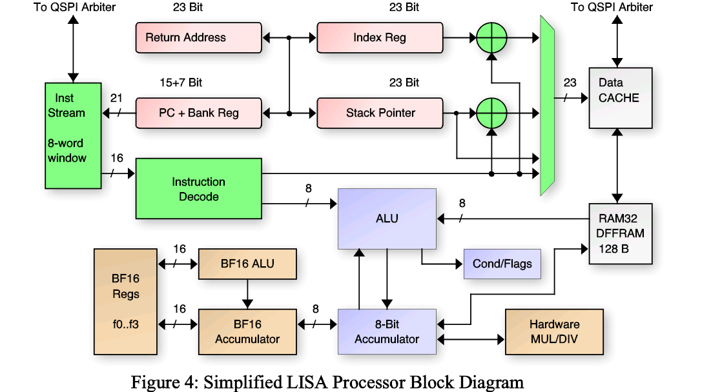

### Addressing Modes

Like most processors, LISA has a few different addressing modes to get data in and out of the core.  These
include the following:

 | Mode     | Data                 | Description                                                    |
 | -------------- | ----------------------- | --------------------------------------------------------------- |
 | Register | Rx[n -: 8]           | Transfers between registers (ix, ra, sp, facc, etc.).          |
 | Direct   | inst[n:0]            | N-bit data stored in the instruction word.                     |
 | NextOp   | (inst+1)[15:0]       | Data stored in the NEXT instruction word (ldx; ldxf uses two). |
 | Indirect | mem[inst[n:0]]       | Address of the data is in the instruction word.                |
 | Periph   | periph[inst[n:0]]    | Accesses to the peripheral bus.                                |
 | Indexed  | mem[sp/ix+inst[n:0]] | The SP or IX register is added to a fixed offset.              |
 | Stack    | mem[sp]              | Stack pointer points to the data (push/pop).                   |
 | Code     | code[ix]             | A byte of code space at IX (lda (ix++), for constant data).    |

### The Control Registers

To run meaningful programs, the Program Counter (PC) and Stack Pointer (SP) must
be set to useful values for accessing program instructions and data.  The PC is automatically reset
to zero by rst_n, so that one is pretty much automatic.  All programs start at address zero (plus 
any base address programmed by the Debug Controller). But as far as the LISA core is concerned, it
knows nothing of base addresses and believes it is starting at address zero.

Next is to program the SP to point to a useful location in memory.  The Stack is a place where C 
programs store their local variable values and also where we store the Return Address (RA) if we need
to call nested routines, etc.  The stack grows down, meaning it starts at a high
RAM address and decrements as things are added to the stack.  Therefore the SP should be programmed
with an address in upper RAM.  Reset sets SP to 0x7FFFFF, the top of the 8 MB data space, so with the
PSRAM present the stack works without any setup.  LISA supports different Data bus modes through its
CACHE controller, including CACHE disable where it can only access the 128 bytes of internal RAM.
The LISA ISA doesn't have an opcode for loading the SP directly.  Instead it can load the IX register
with a 16-bit value (ldx, one word of NextOp data) or a full 24-bit {cond, address} value (ldxf, two
words), and it supports "xchg" opcodes to exchange the IX register with either the SP or RA.
So to load the SP, here to the top of the internal RAM for a program that runs with the cache disabled,
we would write:

    Example:
      ldx     0x007F      // IX <= the next word (bank 0, cond 1)
      xchg_sp             // Exchange IX with SP

The IX register can be programmed as needed to access other data within the Data Bus address range. This
register is useful especially for accessing structures via a C pointer.  The IX then becomes the value
of the pointer to RAM, and Indexed addressing mode allows fixed offsets from that pointer (i.e. structure
elements) to be accessed for read/write.  The three bytes of IX can be moved to and from the accumulator
one at a time (tax / taxu / taxh and txa / txau / txah), and the accumulator can be added to or
subtracted from IX (addax / subax, with "c" forms that include the carry and "u" forms that start at the
middle byte), which is how C pointer arithmetic is done.

Loading the PC indirectly can be done using the "jmp ix" opcode which does the operation pc <= ix[14:0],
and CB <= ix[22:16] when that field is non-zero, so a code pointer carries its bank with it.  Loading
ix from the pc directly is not supported, though this can be accomplished using a function call and opcodes 
to save RA (sra) and pop ix:

     Example:
       get_pc:
         sra         // Push RA to the stack (Save RA)
         pop_ix      // Pop IX from the stack
         ret         // Return. Upon return, IX is the same as PC

### Conditional Flow Processing

Program flow is controlled using flags (zero, carry, sign), arithmetic mode (amode) and condition
flags (cond) to determine when program branches should occur.  Specific opcodes update the flags and
condition registers based on results of the operation (AND, OR, IF, etc.).  Then conditional branches
are made using bz, bnz and if (and variants ifte "if-then-else" and iftt "if-then-then").  Also 
available are rc "Return if Carry" and rz "Return if Zero", though these are less useful in C programs
as typically a routine uses local variables and the stack must be restored prior to return, mandating
a branch to the function epilog to restore the stack and often the return address.  Below is a list
of the opcodes used for conditional program processing:

Legend for operations below:

 - acc_val = inst[7:0]
 - pc_jmp = inst[14:0]
 - pc_rel = pc + sign_extend(inst[10:0])
 - pc_next = the address of the instruction after this one
 - A return address is {cond[1], CB[6:0], 0, pc_next[14:0]}: it carries the code bank and the
   second condition bit (see "The IF Opcode")

 | Opcode  | Operation           | Encoding            | Description                              |
 | ------------- | -------------------- | ---------------------- | ---------------------------------------------- |
 | jal     | pc <= pc_jmp        | 0aaa_aaaa_aaaa_aaaa | Jump And Link (call).                    |
 |         | ra <= pc_next       |                     |                                          |
 | ret     | pc <= ra[14:0]      | 1000_1010_0xxx_xxxx | Return.  CB <= ra[22:16].                |
 | rets    | pc <= ia[14:0]      | 1000_1011_01xx_xxxx | Return from ISR.  CB <= ia[22:16], ie <= 1; |
 |         |                     |                     | C, Z, amode and the saved carry state    |
 |         |                     |                     | are restored from the interrupt shadows. |
 | reti    | pc <= ra[14:0]      | 1000_11xx_iiii_iiii | Return Immediate.  CB <= ra[22:16].      |
 |         | acc <= acc_val      |                     |                                          |
 | br      | pc <= pc_rel        | 1011_0rrr_rrrr_rrrr | Branch Always                            |
 | bz      | pc <= pc_rel        | 1011_1rrr_rrrr_rrrr | Branch if Zero.                          |
 |         | if zero=1           |                     |                                          |
 | bnz     | pc <= pc_rel        | 1010_1rrr_rrrr_rrrr | Branch if Not Zero.                      |
 |         | if zero=0           |                     |                                          |
 | rc      | pc <= ra[14:0]      | 1000_1011_00xx_xxxx | Return if Carry                          |
 |         | if carry=1          |                     |                                          |
 | rz      | pc <= ra[14:0]      | 1000_1011_10xx_xxxx | Return if Zero                           |
 |         | if zero=1           |                     |                                          |
 | call_ix | pc <= ix[14:0]      | 1000_1010_100x_xxxx | Call indirect via IX.  CB <= ix[22:16]   |
 |         | ra <= pc_next       |                     | if non-zero.  IX is incremented, which   |
 |         | ix <= ix + 1        |                     | suits a word of arguments after a call.  |
 | jmp_ix  | pc <= ix[14:0]      | 1000_1010_101x_xxxx | Jump indirect via IX.  CB <= ix[22:16]   |
 |         |                     |                     | if non-zero.                             |
 | if      | cond <= see below   | 1010_0010_00s0_0ccc | If.  See below.                          |
 | iftt    | cond <= see below   | 1010_0010_00s0_1ccc | If then-then.  See below.                |
 | ifte    | cond <= see below   | 1010_0010_00s1_0ccc | If then-else.  See below.                |

Every branch or jump that is taken sets both condition bits to 1.  A return sets cond[1] to 1 and
loads cond[0] from the condition bit saved in the return address (see below).

### The IF Opcode

The "if" opcode and its variants "if-then-then" and "if-then-else" control program flow in a slightly
different manner than the others.  Instead of affecting the value of the PC directly, they set the two
condition bits "cond[1:0]" to indicate which (if any) of the two following opcodes should be executed.
The cond[0] bit represents the next instruction and cond[1] represents the instruction following that. All
three "if" forms take an argument that checks the current value of the FLAGS to set the condition bits.  The
argument is encoded as the lower three bits of the instruction word and operates as shown in the following table:

 | Condition | Test               | Encoding | Description                      |
 | --------------- | -------------------- | -------------- | ----------------------------------- |
 | EQ        | zflag=1            | 3'h0     | Execute if Equal                 |
 | NE        | zflag=0            | 3'h1     | Execute if Not Equal             |
 | NC        | cflag=0            | 3'h2     | Execute if Not Carry             |
 | C         | cflag=1            | 3'h3     | Execute if Carry                 |
 | GT        | ~cSigned & ~zflag  | 3'h4     | Execute if Greater Than          |
 | LT        | cSigned & ~zflag   | 3'h5     | Execute if Less Than             |
 | GTE       | ~cSigned or zflag  | 3'h6     | Execute if Greater Than or Equal |
 | LTE       | cSigned or zflag   | 3'h7     | Execute if Less Than or Equal    |

Bit 5 of the instruction word ("s" in the encodings above) selects a signed comparison for the GT, LT,
GTE and LTE tests.  Every cmp, cpi, sub, add and adc records whether the signs of its two operands
differed; with s = 1, cSigned is the carry flag XOR that bit, which turns the borrow of the compare into
a signed "less than".  With s = 0, cSigned is the carry flag itself and the test is unsigned.  The
assembler spells the signed forms sgt, slt, sge and sle.

The "if" opcode will set cond[0] based on the condition above and the cond[1] bit to HIGH.  It only affects
the single instruction following the "if" opcode.  The "iftt" opcode will set both cond[0] and cond[1] to the
same value based on the condition above.  It means "if true, execute the next two opcodes".  And the "ifte"
opcode will set cond[0] based on the condition above and cond[1] to the OPPOSITE value, meaning it will execute
either the following instruction OR the one after that (then-else).

    Example:
      ldi      0x41        // Load A immediate with ASCII 'A'
      cpi      0x42        // Compare A immediate with ASCII 'B'
      ifte     eq          // Test if the compare was "Equal"
      jal      L_equal     // Jump if equal
      jal      L_different // Jump if different

The above code will load the "jal L_equal" opcode but will not execute it since the compare was Not Equal.
Then it will execute the "jal L_different" opcode.  Note that if the compare were "ifte ne", it would
call the L_equal function and then upon return would not execute the "L_different" opcode.  This is because 
the cond[1] code is saved with the Return Address (RA) during the call and restored upon return.  This means
the FALSE cond[1] code would prevent the 2nd opcode from executing.  As an opcode gets executed, the cond[1]
value is shifted into the cond[0] location, and the cond[1] is loaded with 1'b1.

The result of a condition test can also be captured as data: "ldac ccc" loads the accumulator with 1 or 0
according to the same table (see "Register and other Operations").

### Direct Operations

To do any useful work, the LISA core must be able to load and operate on data.  This is done through the
accumulator using the various addressing modes.  The diagram below details the Direct addressing mode where
data is stored directly in the opcode / instruction word:

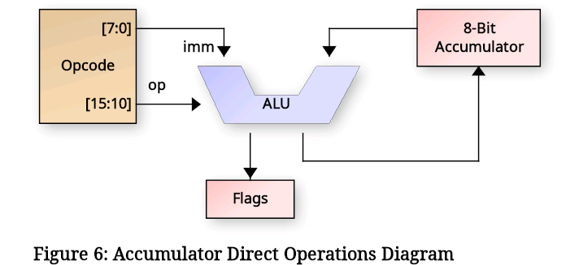
\clearpage
The instructions that use direct addressing are:

 | Opcode | Operation        | Encoding            | Description                              |
 | ------------ | ------------------- | ---------------------- | ------------------------------------------- |
 | adc    | A <= A + imm + C | 1001_00xx_iiii_iiii | ADD immediate with Carry.  C, Z updated. |
 | ads    | SP <= SP + imm   | 1001_01ii_iiii_iiii | ADD SP + signed 10-bit immediate         |
 | adx    | IX <= IX + imm   | 1001_10ii_iiii_iiii | ADD IX + signed 10-bit immediate         |
 | andi   | A <= A & imm     | 1101_01xx_iiii_iiii | AND immediate with A.  Z updated.        |
 | cpi    | C <= A < imm     | 1010_01xx_iiii_iiii | Compare A with immediate: C is the       |
 |        | Z <= A == imm    |                     | borrow of A - imm (unsigned)             |
 | ldi    | A <= imm         | 1000_00xx_iiii_iiii | Load A immediate.  C <= 0, Z <= imm == 0 |

### Accumulator Indirect / Peripheral Operations

The Accumulator Indirect operations use immediate data in the instruction word to index
indirectly into Data memory or peripheral space.  That memory address is then used to load, store or both
load and store (swap) data with the accumulator.

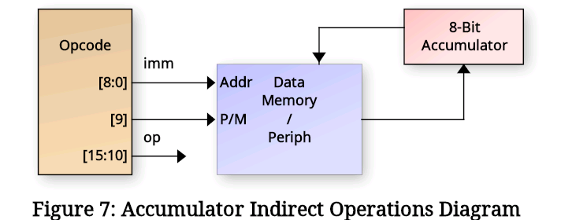

 | Opcode | Operation   | Encoding            | Description                   |
 | ------------ | ----------------- | ---------------------- | -------------------------------- |
 | lda    | A <= M[imm] | 1111_01pi_iiii_iiii | Load A from Memory/Peripheral |
 | sta    | M[imm] <= A | 1111_11pi_iiii_iiii | Store A to Memory/Peripheral  |
 | swapi  | A <= M[imm] | 1101_11pi_iiii_iiii | Swap Memory/Peripheral with A |
 |        | M[imm] <= A |                     |                               |

 - p = Select Peripheral (1'b1) or RAM (1'b0)
 - iiii = 9-bit address (0 - 511) in RAM or peripheral space

### Indexed Operations

Indexed operations use either the IX or SP register plus a fixed offset from the immediate field of the 
opcode.  The selection to use IX vs SP is also from the opcode[9] bit.  The immediate field is not
sign extended, so only positive direction indexing is supported.  This was selected because this mode
is typically used to access either local variables (when using SP) or C struct members (when using IX), 
and in both cases, negative index offsets aren't very useful.  The following is a diagram of indexed addressing:

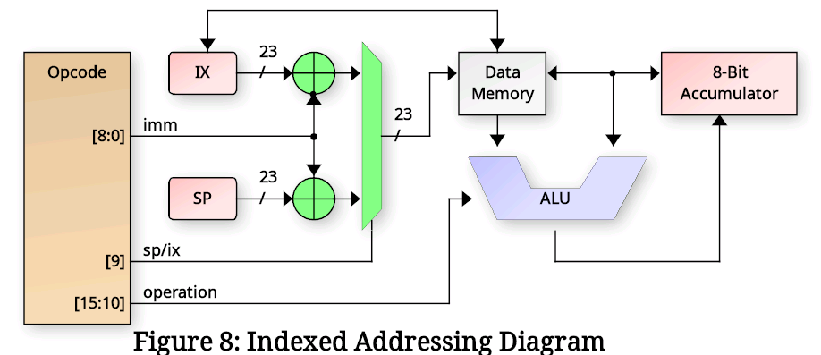

 | Opcode | Operation          | Encoding            | Description                                  |
 | ------------ | ------------------------ | ---------------------- | ------------------------------------------------- |
 | add    | A <= A + M[ind]    | 1100_00si_iiii_iiii | ADD index memory to A (no carry in)          |
 | and    | A <= A & M[ind]    | 1101_00si_iiii_iiii | AND A with index memory                      |
 | cmp    | C <= A < M[ind]    | 1110_10si_iiii_iiii | Compare A with index memory: C is the borrow |
 |        | Z <= A == M[ind]   |                     | of A - M (unsigned), Z the equality          |
 | dcx    | M[ind] -= 1        | 1001_11si_iiii_iiii | Decrement the value at index memory          |
 | inx    | M[ind] += 1        | 1110_01si_iiii_iiii | Increment the value at index memory          |
 | ldax   | A <= M[ind]        | 1111_00si_iiii_iiii | Load A from index memory                     |
 | ldxx   | IX <= M[SP+imm]    | 1100_110i_iiii_iiii | Load the 3-byte IX from memory at SP+imm     |
 | mul    | A <= (A*M[ind])[7:0]  | 1100_01si_iiii_iiii | Multiply A by index memory, keep the low byte |
 | mulu   | A <= (A*M[ind])[15:8] | 1000_01si_iiii_iiii | Multiply A by index memory, keep the high byte |
 | or     | A <= A or M[ind]   | 1101_10si_iiii_iiii | OR A with index memory                       |
 | stax   | M[ind] <= A        | 1111_10si_iiii_iiii | Store A to index memory                      |
 | stxx   | M[SP+imm] <= IX    | 1100_111i_iiii_iiii | Save the 3-byte IX to memory at SP+imm       |
 | sub    | A <= A - M[ind] - C | 1100_10si_iiii_iiii | SUBtract index memory and the borrow from A |
 | swap   | A <= M[ind]        | 1110_11si_iiii_iiii | Swap A with index memory (flags unchanged)   |
 |        | M[ind] <= A        |                     |                                              |
 | xor    | A <= A ^ M[ind]    | 1110_00si_iiii_iiii | XOR A with index memory                      |

\clearpage
Legend for table above:

 - ind = IX or SP + immediate
 - s = Select IX (zero) or SP (one)
 - iiii = Immediate data (a 9-bit offset, 0 - 511)
 - mul and mulu multiply signed when amode[1] is set, unsigned otherwise
 - sub subtracts the carry flag as a borrow (C = 1 means a borrow is pending); clear C first with
   "ldc 0" for a plain subtract.  add has no carry in; adc (immediate) is the add with carry.
 - ldxx and stxx move the three bytes of IX: M[SP+imm] = IX[7:0], M[SP+imm+1] = IX[15:8] and
   M[SP+imm+2] = {cond, IX[22:16]}.  They take two instruction cycles.

The Zero and Carry flags are updated for most of the above operations.  Z is set from the value
loaded into the accumulator by every accumulator load (ldi, ldax, lda, pop a, txa, the shifts,
the ALU results) except swap, swapi, shl16 and shr16; the Carry flag is only updated for math
operations where a Carry / Borrow could occur.

 | Carry | Zero        |
 | ----------- | ----------------- |
 | adc   | add    and  |
 | add   | or     xor  |
 | sub   | cmp    sub  |
 | cmp   | dcx    inx  |    
 | dcx   | ldax   mul  |
 | inx   | mulu   adc  |
 | cpi   | cpi    andi |
 | shl   | ldi    shl  |
 | shr   | shr         |

 - dcx: C = 1 when the byte was 0 (it wrapped to 0xFF), Z = 1 when the result is 0.
 - inx: C = 1 when the byte was 0xFF, Z = 1 when the result is 0.

### Stack Operations

Stack operations use the SP register to PUSH and POP items to the stack in a single opcode.  A push
decrements SP first and writes at the new SP, so SP always holds the address of the byte on top of the
stack and 0(sp) is the top of a frame.  A pop reads the byte at SP and then increments SP.  The three
bytes of RA and IX go on the stack with {cond, bits 22:16} at the lowest address (the top), then the
middle byte, then the low byte; these four opcodes take three data cycles each.

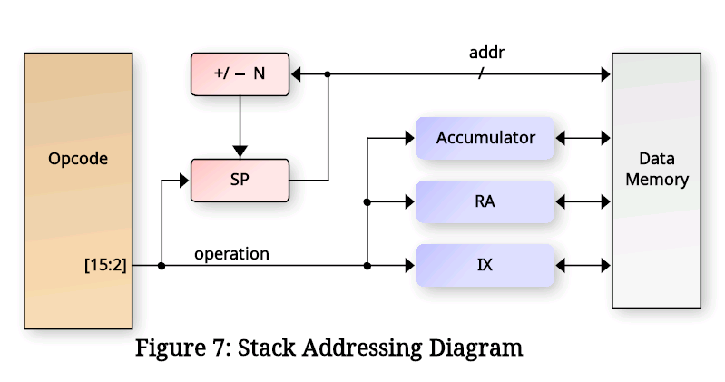

 | Opcode  | Operation                     | Encoding            | Description               |
 | ------------- | ------------------------------- | ---------------------- | ---------------------------- |
 | sra     | M[SP-1] <= RA[7:0]            | 1010_0001_0110_00xx | Save {cond,RA} to stack   |
 |         | M[SP-2] <= RA[15:8]           |                     |                           |
 |         | M[SP-3] <= {cond, RA[22:16]}  |                     |                           |
 |         | SP -= 3                       |                     |                           |
 | lra     | {cond, RA[22:16]} <= M[SP]    | 1010_0001_0110_01xx | Load {cond,RA} from stack |
 |         | RA[15:8] <= M[SP+1]           |                     |                           |
 |         | RA[7:0] <= M[SP+2]            |                     |                           |
 |         | SP += 3                       |                     |                           |
 | push_ix | as sra, with IX               | 1010_0001_0110_10xx | Save {cond,IX} to stack   |
 |         | SP -= 3                       |                     |                           |
 | pop_ix  | as lra, with IX               | 1010_0001_0110_11xx | Load {cond,IX} from stack |
 |         | SP += 3                       |                     |                           |
 | push_a  | M[SP-1] <= A                  | 1010_0000_10xx_xxxx | Save A to stack           |
 |         | SP -= 1                       |                     |                           |
 | pop_a   | A <= M[SP]                    | 1010_0000_11xx_xxxx | Load A from stack         |
 |         | SP += 1                       |                     |                           |

### Register and other Operations

Register operations operate exclusively on internal registers, such as exchanging
between two regs, shifting, complementing, etc.  Also there are a few miscellaneous
opcodes for things like setting arithmetic mode, loading the C flag, etc.

 | Opcode  | Operation               | Encoding            | Description                                  |
 | ---------------- | ------------------------- | ---------------------- | ------------------------------------------------ |
 | addax   | IX <= IX + A            | 1010_0001_101x_x000 | Add A to IX (23-bit result)                  |
 | addaxc  | IX <= IX + A + C        | 1010_0001_101x_x100 | Add A and the carry to IX                    |
 | addaxu  | IX[22:8] <= IX[22:8]+A  | 1010_0001_101x_x001 | Add A to the upper bytes of IX               |
 | subax   | IX <= IX - A            | 1010_0001_101x_x010 | Subtract A from IX                           |
 | subaxc  | IX <= IX - A - C        | 1010_0001_101x_x110 | Subtract A and the borrow from IX            |
 | subaxu  | IX[22:8] <= IX[22:8]-A  | 1010_0001_101x_x011 | Subtract A from the upper bytes of IX        |
 | amode   | amode <= mmm            | 1010_0001_0100_0mmm | Set the arithmetic mode (reset value 1)      |
 | brk     | Breakpoint              | 1010_0000_0111_11xx | Halt the processor (debugger)                |
 | btst    | Z <= A[bbb]             | 1010_0000_010x_xbbb | Test bit bbb of A                            |
 | cpx_ra  | C <= IX < RA            | 1000_1010_1101_00xx | Compare IX with RA (all 23 bits)             |
 |         | Z <= IX == RA           |                     |                                              |
 | cpx_sp  | C <= IX < SP            | 1000_1010_1101_10xx | Compare IX with SP (all 23 bits)             |
 |         | Z <= IX == SP           |                     |                                              |
 | di / ei | ie <= f                 | 1010_0000_0111_10xf | Disable (f=0) / enable (f=1) interrupts      |
 | ldac    | A <= cond(ccc) ? 1 : 0  | 1010_0001_110x_xccc | Load A with a condition test (IF table)      |
 | ldamode | A <= {0000, ie, amode}  | 1010_0001_0100_10xx | Read ie and amode                            |
 | ldc     | C <= b                  | 1010_0000_0000_1xxb | Load C flag with b                           |
 | ldirq   | A <= ISR shadows        | 1010_0001_0010_00xx | Load A with the interrupt shadow state       |
 | lda (ix++) | A <= code[IX]        | 1010_0001_0100_11xx | Load A from code space at IX, IX += 1        |
 |         | IX <= IX + 1            |                     | (bank IX[22:16], word IX[15:1], byte IX[0])  |
 | ldx     | IX <= {1, 0, imm16}     | 1010_0001_1000_xxxx | Load IX with the next word (bank 0, cond 1)  |
 |         |                         | iiii_iiii_iiii_iiii |                                              |
 | ldxf    | {cond, IX} <= imm24     | 1010_0001_1001_xxxx | Load IX with the next two words: the low     |
 |         |                         | iiii_iiii_iiii_iiii | 16 bits, then {cond, IX[22:16]} in the low   |
 |         |                         | xxxx_xxxx_chhh_hhhh | byte of the second                           |
 | ldz     | Z <= b                  | 1010_0000_0110_xx0b | Load Z flag with b                           |
 | ldz     | Z <= ~Z                 | 1010_0000_0110_xx10 | Complement Z                                 |
 | ldz     | Z <= C                  | 1010_0000_0110_xx11 | Copy C to Z                                  |
 | nop     | No operation            | 1010_0000_0111_00xx |                                              |
 | notz    | Z <= A != 0             | 1010_0000_0111_01xx | Z <= 1 when A is non-zero (the inverse sense) |
 | restc   | C, sign <= saved        | 1010_0001_0111_11xx | Restore the carry state saved by savec       |
 | savec   | saved <= C, sign        | 1010_0001_0111_10xx | Save C and the signed-compare bit            |
 | shl     | A <= {A[6:0], in}       | 1010_0000_0000_00xx | Shift A left: C <= A[7], in = amode[0] & C   |
 | shl16   | {M[SP+ii], A} <<= 1     | 1010_0000_0010_xxii | 16-bit shift left, A the low byte; C, Z kept |
 | shr     | A <= {in, A[7:1]}       | 1010_0000_0000_01xx | Shift A right: C <= A[0],                    |
 |         |                         |                     | in = (amode[0] & C) or (amode[1] & A[7])     |
 | shr16   | {M[SP+ii], A} >>= 1     | 1010_0000_0011_xxii | 16-bit shift right, A the low byte; C, Z kept |
 | spix    | IX <= SP                | 1000_1010_1100_11xx | Load IX from SP                              |
 | stirq   | ISR shadows <= A        | 1010_0001_0010_01xx | Write the interrupt shadow state from A      |
 | tax     | IX[7:0] <= A            | 1010_0001_0000_0xxx | Transfer A to the low byte of IX             |
 | taxu    | IX[15:8] <= A           | 1010_0001_0000_1xxx | Transfer A to the middle byte of IX          |
 | taxh    | {cond, IX[22:16]} <= A  | 1010_0001_0001_0xxx | Transfer A to the top byte of IX             |
 | txa     | A <= IX[7:0]            | 1010_0000_0001_00xx | Transfer the low byte of IX to A             |
 | txau    | A <= IX[15:8]           | 1010_0000_0001_10xx | Transfer the middle byte of IX to A          |
 | txah    | A <= {cond, IX[22:16]}  | 1010_0000_0001_01xx | Transfer the top byte of IX to A             |
 | xchg_ia | IA <=> IX               | 1000_1010_1100_01xx | Exchange IA with IX                          |
 | xchg_ra | RA <=> IX               | 1000_1010_1100_00xx | Exchange RA with IX                          |
 | xchg_sp | SP <=> IX               | 1000_1010_1100_10xx | Exchange SP with IX                          |
 | sleep   | wait for an interrupt   | 1010_0000_0001_11xx | Stop until an enabled source is pending      |

Notes:

 - amode[0] = 1 makes shl / shr / shl16 / shr16 rotate through the carry; amode[1] = 1 selects signed
   arithmetic (signed mul / mulu / div / rem, an arithmetic shr that keeps the sign, sign-extended
   divider operands, signed itof / ftoi); amode[2] = 1 makes the BF16 fadd and fdiv round toward zero
   instead of to nearest even.  Reset leaves amode = 1.
 - The 16-bit shifts treat the stack byte at SP+ii as the high byte and A as the low byte.  shl16
   shifts amode[0] & C into A[0] and A[7] into the stack byte; shr16 shifts the stack byte's bit 0
   into A[7] and (amode[0] & C) or (amode[1] & M[7]) into the top.  The bit shifted out at the far
   end is dropped: unlike shl / shr they leave C and Z as they were.  They take two data cycles.
 - "ldirq" and "stirq" move the state that an interrupt saves and "rets" restores, as one byte:
   bit 0 C, bit 1 Z, bit 2 the signed-compare bit, bit 3 the carry saved by savec, bit 4 the live
   signed-compare bit and bits 7:5 amode.  An ISR that must nest, or a context switch, saves and
   restores this byte around the IA (xchg_ia).  The BF16 registers are not saved: an ISR that uses the
   floating point unit saves facc and f0 - f3 itself.
 - "savec" / "restc" keep one copy of C and the signed-compare bit for a compare that must survive
   intervening arithmetic (the compiler uses them around pointer adjustments).
 - "lda (ix++)" reads code space: the word at IX[15:1] of the bank in IX[22:16] (with the same
   window rule as instruction fetches: IX[15] = 0 reads bank 0), the low byte when IX[0] = 0 and the
   high byte when IX[0] = 1, then increments IX.  It is how constant data (strings, tables) is read
   out of the flash without copying it to RAM.
 - "sleep" holds the core in the instruction, fetching nothing, until an interrupt source that is
   enabled is pending (whether or not interrupts are enabled with ei) or the debugger halts it.  With
   interrupts enabled the handler runs before the next instruction; with them disabled execution simply
   continues.  An idle loop of "sleep" keeps the QSPI quiet between events.

### The Divider

The core has a 16-bit restoring divider.  The dividend and divisor are assembled from the registers
and, optionally, the stack; a division takes 16 clocks during which the core is stalled, and both the
quotient and the remainder come out of every division.

 | Opcode | Operation                    | Encoding            | Description                              |
 | ------------ | --------------------------- | ---------------------- | ------------------------------------------ |
 | div    | RA <= dividend / divisor     | 1010_0011_0000_xxdv | Divide.  A <= RA[7:0] (the low byte of   |
 |        | IX <= dividend % divisor     | (+ word when v = 0) | the quotient)                            |
 | rem    | RA <= dividend % divisor     | 1010_0011_0001_xxdv | Remainder.  A <= RA[7:0] (the low byte   |
 |        | IX <= dividend / divisor     | (+ word when v = 0) | of the remainder)                        |
 | lddiv  | IX[7:0] <= A                 | 1010_0001_0111_00xx | Load a 16-bit dividend: the low byte     |
 |        | RA[7:0] <= M[SP+n]           | xxxx_xxxn_nnnn_nnnn | from A, the high byte from the stack     |
 | divc   | RA[7:0], A <= {IX,A} / D     | 1010_0001_0111_01xx | Chained step: divide the 24-bit {IX, A}  |
 |        | IX <= {IX,A} % D             |                     | by the divisor D kept from the last      |
 |        |                              |                     | division, 8 clocks, unsigned             |

 - The dividend is {RA[7:0], IX[7:0]} when d = 0, or IX[7:0] extended to 16 bits when d = 1.
 - The divisor is {M[SP+n], A} when v = 0, with the 9-bit stack offset n in the word that follows
   the opcode, or A extended to 16 bits when v = 1.
 - The extension is a sign extension when amode[1] = 1 and zeros otherwise.  With amode[1] = 1
   the division is signed: the quotient is negative when the operands' signs differ and the
   remainder takes the dividend's sign.  -32768 / -1 gives -32768.
 - Division by zero gives a quotient of 0xFFFF and the dividend as the remainder.
 - "divc" is the step of a long division of any width by a 16-bit divisor: after a division (or a
   previous divc) IX holds the remainder, which is below the divisor; divc appends the next byte of
   the dividend from A, divides, leaves the next quotient byte in A (and RA[7:0]) and the new
   remainder in IX.  The compiler uses it for 32-bit and 64-bit division.

### Floating Point (BF16) Operations

LISA has a small hardware floating point unit that works on Brain Float 16 (BF16) numbers.  BF16 is simply
the upper 16 bits of an IEEE-754 32-bit float ... 1 sign bit, 8 exponent bits and 7 fraction bits.  So it
has the same range as a regular C float (about 1e-38 to 3e38), just with fewer digits of precision (2 to 3
decimal digits), and converting to / from a 32-bit float is just dropping / adding the lower 16 bits.

The FPU has five 16-bit registers:

   - facc: the floating point accumulator.  Every operation leaves its result here.
   - f0 - f3: four floating point registers used as the 2nd operand (selected by the 'ff' bits in the opcode).

There are no load / store opcodes for the floating point registers.  Instead, data gets in and out through
the 8-bit accumulator one byte at a time using 'taf' (A to facc) and 'tfa' (facc to A), and the
f0 - f3 registers are loaded by swapping them with facc using 'fswap'.  So to multiply two numbers
the code loads the first one into facc, swaps it into f0, loads the second into facc and then does the
multiply:

```
    lda    a_lo        ; First operand to f0
    taf    0
    lda    a_hi
    taf    1
    fswap  f0
    lda    b_lo        ; Second operand to facc
    taf    0
    lda    b_hi
    taf    1
    fmul   f0          ; facc <= facc * f0
    tfa    0           ; Read the result back
    sta    r_lo
    tfa    1
    sta    r_hi
```

All of the floating point opcodes are predicated by the cond latch just like the other opcodes, and
they all complete in a single instruction cycle except for 'fdiv', which holds the processor for the
few clocks the divider takes.  The amode register (see 'The Control Registers') controls two things:

   - amode[1]: Selects signed (1) or unsigned (0) 16-bit integers for 'itof' and 'ftoi'.
   - amode[2]: Selects round toward zero (1) or round to nearest even (0) for 'fadd' and 'fdiv'.

 | Opcode  | Operation        | Encoding            | Description                        |
 | ------------ | ---------------------- | ---------------------- | --------------------------------------- |
 | taf     | facc[h] <= A     | 1010_0001_1110_001h | Load half of facc (h=1 upper) from A |
 | tfa     | A <= facc[h]     | 1010_0001_1110_000h | Load A from half of facc (h=1 upper) |
 | fswap   | facc <=> fx      | 1010_0001_1111_00ff | Exchange facc with f0 - f3         |
 | fneg    | fx <= -fx        | 1010_0001_1110_11ff | Negate f0 - f3 (flips the sign bit)|
 | fadd    | facc += fx       | 1010_0001_1110_10ff | Add fx to facc                     |
 | fmul    | facc *= fx       | 1010_0001_1110_01ff | Multiply facc by fx                |
 | fdiv    | facc /= fx       | 1010_0001_1111_10ff | Divide facc by fx, C=1 if valid    |
 | fcmp    | C,Z <= facc ? fx | 1010_0001_1111_01ff | Compare facc with fx               |
 | itof    | facc <= float(facc) | 1010_0011_0010_0000 | Convert 16-bit integer to BF16  |
 | ftoi    | facc <= int(facc)   | 1010_0011_0010_0001 | Convert BF16 to 16-bit integer  |
 | fclr    | facc <= 0        | 1010_0011_0010_0010 | Clear facc                         |

Subtraction is done with 'fneg' followed by 'fadd'.  Note that 'fneg' works on the fx register, not facc, so
the value being subtracted is the one in f0 - f3.  A few details of the individual operations:

   - fadd: Rounds per amode[2] and handles subnormal (denormal) numbers.
   - fmul: Truncates the product (no rounding).  Subnormal inputs and results are flushed to zero.
   - fdiv: Uses a two-step Goldschmidt iteration from a small reciprocal table and rounds per amode[2].  The
     result can be off by one in the last bit now and then.  The C flag is set when the result is valid and
     cleared for the infinity / NaN / divide by zero cases.
   - fcmp: Z is set when the two values have the same bit pattern (so -0 and +0 compare unequal).  C is set
     when facc > fx, with the signs taken into account.  The 'if' opcode can then be used to branch on the result.
   - itof: Converts the 16-bit integer in facc (signed or unsigned per amode[1]), rounding half up.
   - ftoi: Converts facc to a 16-bit integer in facc, truncating toward zero.  Values that are too big
     saturate (65535 unsigned, 32767 / -32768 signed), and a negative value gives 0 in unsigned mode.

To convert an integer, put it in facc with 'taf' (low byte, then high byte), do 'itof' or 'ftoi', and read
the result back with 'tfa'.  The facc and f0 - f3 registers can also be read through the debug interface
(registers 0x30 - 0x34), and they are all cleared to zero at reset.

## LISA Peripheral Registers

The peripheral space is reached with the p bit of lda / sta / swapi (addresses 0 - 511; in C, an `__sfr` at
0x200 + address).  The processor's own peripherals occupy 0x00 - 0x1E; the other blocks have their own sections:
the I2C master at 0x20 - 0x26, the SPI master at 0x28 - 0x2B, the TTLC I/O at 0x2C - 0x2E, Timer 3 at
0x30 - 0x3F, the WS2812B driver at 0x40 - 0x45, the cycle counter at 0x48 - 0x4B, the watchdog at 0x4C - 0x4F,
the PLC timers and counters at 0x50 - 0x59, the high-speed counters at 0x60 - 0x6F and the stack pointer limit
at 0x7A - 0x7D.  Unlisted addresses (0x70 - 0x79 among them) read 0 and ignore writes.

 | ADDR | Register    | Bits  | Reset  | Description                                                              |
 | ----------------- | ----------------- | ----------- | ----------- | --------------------------------------------------------------- |
 | 0x00 | PORTA       | [7:0] | pins   | Port A input: the ui_in pins.  Writes ignored.                           |
 | 0x01 | PORTB       | [7:0] | 0x00   | Port B output latch (uo_out in mux mode 1); reads back the latch         |
 | 0x02 | PORTC       | [3:0] | 0x0    | Port C (uio[7:4] in io mux mode 1): write the output latch; a read gives the pin for an input bit and the latch for an output bit |
 | 0x03 | PORTC_DIR   | [3:0] | 0x0    | Port C direction, 1 = output                                             |
 | 0x04 | PORTD       | [7:0] | -      | Input from the TTLC: its storage bits 0 - 7.  Writes ignored.            |
 | 0x05 | PORTE       | [7:0] | 0x00   | Output to the TTLC: its I/O addresses 128 - 135                          |
 | 0x06 | PA_INT_CFG0 | [7:0] | 0x00   | Port A interrupt mode, low bit for pin n                                 |
 | 0x07 | PA_INT_CFG1 | [7:0] | 0x00   | Port A interrupt mode, high bit: {CFG1[n], CFG0[n]} = 0 off, 1 level high, 2 rising edge, 3 falling edge |
 | 0x08 | T1_PRE_L    | [7:0] | 0x36   | Timer 1 prescaler [7:0]                                                  |
 | 0x09 | T1_PRE_H    | [7:0] | 0x73   | Timer 1 prescaler [15:8]: one tick every PRE + 1 clocks (reset 29495)    |
 | 0x0A | T1_PERIOD_L | [7:0] | 0x00   | Timer 1 period [7:0]                                                     |
 | 0x0B | T1_PERIOD_H | [7:0] | 0x00   | Timer 1 period [15:8]: a rollover every PERIOD ticks (0 = 65536)         |
 | 0x0C | T1_CTRL     | [0]   | 0      | EN: the timer runs.  Bit [7] ROLLOVER: set at a rollover, cleared by reading 0x0C or writing 0x0D |
 | 0x0D | T1_TICK     | [7:0] | 0x00   | Counts rollovers.  A write loads it, reloads the period and clears ROLLOVER |
 | 0x0E | INT_ENABLE  | [7:0] | 0x00   | Bit n enables interrupt source n (table below)                           |
 | 0x0F | INT_STATUS  | [7:0] | 0x00   | Bit n is source n's request.  Writing a 1 to bits 0, 1, 4 or 5 clears that latched request; bits 2, 3, 6 and 7 are levels from their peripherals |
 | 0x10 | UART1_DATA  | [7:0] | -      | Write: send a byte.  Read: take the received byte (clears RX_AVAIL)      |
 | 0x11 | UART1_STAT  | [2:0] | -      | [0] RX_AVAIL, [1] TX_EMPTY (reads 0 while the debugger owns the UART), [2] OVERRUN (the 8-byte FIFO was full; clears when it is read empty) |
 | 0x12 | UART2_DATA  | [7:0] | -      | Write: send a byte.  Read: the oldest byte of the 8-byte FIFO, popped    |
 | 0x13 | UART2_STAT  | [6:0] | 0      | [0] RX_AVAIL, [1] TX_READY (the transmit FIFO has room), [2] AUTOBAUD_DIS (r/w), [3] OVERRUN, [4] TX_IDLE (FIFO empty and the line idle), [5] IDLE_FLAG (the idle timer fired), [6] DE (the direction output's state) |
 | 0x14 | UART_IE     | [3:0] | 0      | Interrupt enables: [0] UART1 RX, [1] UART1 TX, [2] UART2 RX, [3] UART2 TX |
 | 0x15 | CODE_BANK   | [6:0] | 0x01   | CB: the bank fetched at word addresses 0x4000 and above.  Also written by call ix / jmp ix / ret / rets |
 | 0x16 | UART2_IDLE  | [7:0] | 0x00   | The idle timer's threshold in bit times of receive silence (0: off) |
 | 0x17 | UART2_CTRL  | [3:0] | 0x0    | [0] DE_EN: uo[7] in uo mux 2 is the RS-485 direction, [1] DE_POL: 1 = active low, [2] IDLE_CLR: a 1 written clears IDLE_FLAG (reads 0), [3] IDLE_IE: IDLE_FLAG joins UART2's interrupt request |
 | 0x18 - 0x1D | Timer 2 |     |        | As 0x08 - 0x0D, for Timer 2 (interrupt source 1)                         |
 | 0x1E | UART2_DIV   | [7:0] | 12     | Write only: a bit is 32 x (DIV + 1) clocks.  13 gives 111.6 kbaud for 115200 at 50 MHz (the reset value is 120 kbaud) |

Things to know:

  - UART1 is the debug UART.  The program has it only after the debugger's `l` command (TX_EMPTY reads 0 and
    nothing is sent before that), and `+++` takes it back.  Its baud rate is the debug port's.
  - UART2 has its own autobaud: until AUTOBAUD_DIS (0x13 bit 2) is set, three pulses of the same width on its
    RX (a LINEFEED, 0x0A, or a 'U', 0x55) set its bit period, as for the debug UART, replacing any UART2_DIV
    value.  Set AUTOBAUD_DIS when the program fixes the rate with UART2_DIV.
  - The UART interrupts are levels: RX while a byte waits, TX while the transmitter is empty, each gated by
    its UART_IE bit; a TX interrupt handler clears the enable when it has nothing more to send.
  - A Port A level-mode pin re-raises INT_STATUS bit 4 every clock it is high, so the clear takes effect only
    once the pin has dropped.  There is no per-pin status: the handler reads PORTA.
  - Reading T1_CTRL / T2_CTRL clears ROLLOVER but not the interrupt request, which is cleared in INT_STATUS.
  - With EN clear a timer holds TICK at 0, so write TICK after enabling.

### UART2 for Modbus RTU

UART2 has what an RS-485 field bus needs.  Its transmit FIFO holds eight bytes behind the transmitter's own
buffer: TX_READY (0x13 bit 1) is "the FIFO has room", so a polling putc keeps its loop and a burst of nine
bytes goes out without a wait (a tenth written while the FIFO is full is dropped).  TX_IDLE (bit 4) is set
when the FIFO is empty and the last stop bit has left the pin.

With DE_EN (0x17 bit 0) set, uo[7] in uo_out mux 2 carries the direction output instead of tx2: active from
the clock the first byte is queued into an idle transmitter until TX_IDLE, so it covers the last stop bit
without any software timing; DE_POL inverts it for transceivers with an active-low enable.  DE (bit 6 of
0x13) reads its state.

The idle timer frames Modbus RTU: a counter of bit times restarts at every receive activity (any edge on RX,
a byte completing) and when it reaches UART2_IDLE (0x16) IDLE_FLAG is set and stays set until IDLE_CLR is
written as 1.  The Modbus gap of 3.5 characters is 39 bit times at 19200 baud and below; above that the
standard fixes it at 1.75 ms, which the program converts to bit times for its rate.  Thresholds of 10 and
more are safe with any data (a byte of 0x00 or 0xFF has no edge for about 9.5 bit times).  With IDLE_IE
set the flag joins UART2's interrupt request (source 3, vector 4) beside the RX / TX enables of 0x14, so a
handler can collect a whole frame on one interrupt.

### Interrupts

The core takes an interrupt between instructions when ie is set (ei / di), a source is pending in
INT_STATUS AND INT_ENABLE (or Timer 3, the high-speed counters or the stack limit request through their own
IEs), and cond is 11 (not after if / iftt /
ifte, nor between the words of a two-word instruction, nor after ei / di, stirq or xchg ia).  It saves the
return address and code bank in IA, saves C, Z, amode and the carry-save state in the interrupt shadows
(ldirq / stirq read and write them), clears ie and jumps to word (source + 1) of bank 0; the lowest-numbered
pending source wins.  The jal at the vector does not overwrite RA, so the handler is an ordinary function
that ends with rets.  With sdcc a handler is declared `void handler(void) __interrupt(n)` with n the vector.

 | Source | Vector | Peripheral     | Request                                                   | Acknowledge                          |
 | ------------ | ------------ | -------------------- | --------------------------------------------------------------- | -------------------------------------------------------- |
 | 0      | 1      | Timer 1        | Rollover (latched)                                        | Write 1 to INT_STATUS bit 0          |
 | 1      | 2      | Timer 2        | Rollover (latched)                                        | Write 1 to INT_STATUS bit 1          |
 | 2      | 3      | UART1          | RX byte waiting and UART_IE[0], or TX empty and UART_IE[1] | Read / write UART1_DATA, or clear the enable |
 | 3      | 4      | UART2          | The same with UART_IE[3:2]                                | Read the FIFO empty / write, or clear the enable |
 | 4      | 5      | Port A         | A pin's mode condition (latched)                          | Write 1 to INT_STATUS bit 4          |
 | 5      | 6      | TTLC / WS2812B | Either edge of TTLC storage bit 8 (latched); the WS2812B driver's request while its IE is set | Write 1 to INT_STATUS bit 5 / the WS2812B's own flags |
 | 6      | 7      | I2C            | IF: a byte done or arbitration lost                       | CMD with IACK                        |
 | 7      | 8      | SPI master     | DONE with CTRL IE set                                     | Read or write DATA                   |
 | 8      | 9      | Timer 3        | Any event enabled in its IE (not in INT_ENABLE / INT_STATUS) | Write 1 to its STATUS bit           |
 | 9      | 10     | HSC0 / HSC1    | MATCH, OVF or UNF with the counter's IE set (not in INT_ENABLE / INT_STATUS) | Write 1 to the flag in its STAT |
 | 10     | 11     | SP limit       | FAULT with IE set (not in INT_ENABLE / INT_STATUS)            | Write 1 to FAULT (and clear EN)      |

## The Tiny Tapeout Logic Controller (TTLC)

The second subsystem within this design is a small PLC type circuit.  It is architected around a 1-bit processor from 1977
designed by Motorola ... the MC14500B Industrial Control Unit (ICU).  The TTLC wraps the ICU "processor" with an instruction
fetch pipeline and a bit-level I/O subsystem.

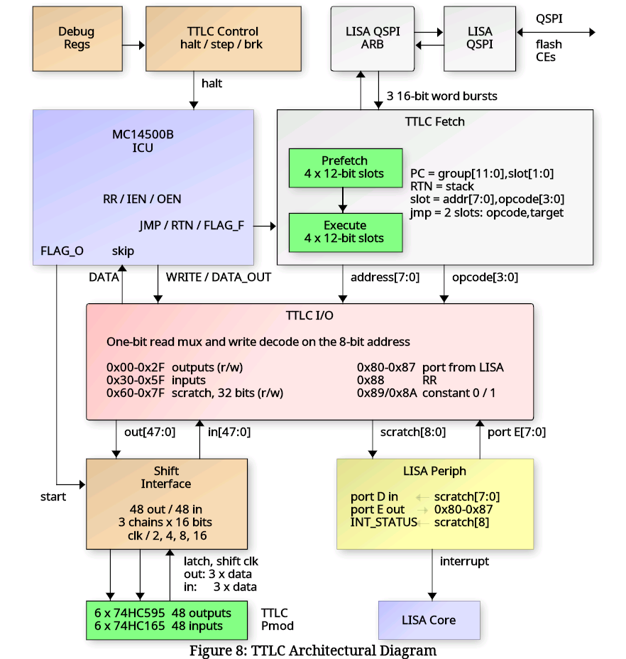

The instruction fetch pipeline uses 12-bit instructions (slots): the 4-bit MC14500B opcode in the low bits and the
8-bit operand, the I/O bit address, above it, {address[7:0], opcode[3:0]}.  Four slots make a 48-bit group of three
16-bit words, slot k of group g in bits [12k+11:12k] of the group (slot 0 in the low 12 bits of the group's first
word, word 3g of the program).  The 14-bit Program Counter (PC) is {group[11:0], slot[1:0]}: 4096 groups, up to
16K instructions, read from the TTLC's QSPI chip select at its base address (Debug register 0x1F).  A 'jump' (JMP, opcode 0xC) takes two
slots: its own ({8'h00, 4'hC}) and the next, which holds the 12-bit target group, so a jump always lands on slot 0
of a group; the pair must stay inside one group and every label starts a group, which the "assembler" takes care
of.  JMP pushes the address after the pair on a 4-entry return stack and RTN (opcode 0xD) pops it.  Two groups
are buffered, the one executing and the next, each fetched in one three-word QSPI burst.

The I/O subsystem uses an 8-bit address and supports the following:

   - 48-Outputs plus 48-Inputs via external 74HC595 / 74HC165 chips
   - 128-Bit internal storage
   - 16 bit I/O to/from LISA (8 each direction)
   - Six timers and four counters (the PLC block) and the two high-speed counters' compare bits
   - Ability to send interrupt to LISA
   - Constant zero / one bits 

The 8-bit address selects one bit of the I/O space:

 | Address | Contents                                                   |
 | ------------- | --------------------------------------------------------------- |
 | 0-47    | Outputs (to the 74HC595 chains)                            |
 | 48-95   | Inputs (from the 74HC165 chains)                           |
 | 96-127  | Internal storage bits 0-31 (bits 0-7 are Port D to LISA; a change of bit 8, either edge, interrupts LISA) |
 | 128-135 | The 8 bits from LISA (Port E)                              |
 | 136     | RR (the result register)                                   |
 | 137     | Constant 0                                                 |
 | 138     | Constant 1                                                 |
 | 139-146 | Timers T0-T5 at 139-144: a write (STO / STOC) is the timer's input IN, a read its output Q; 145-146 (no timer) read 0 |
 | 147-154 | Counters C0-C3 at 147-150: a write is the count input CU (its rising edge counts), a read its output Q; 151-154 (no counter) read 0 |
 | 155-156 | HSC0 / HSC1: count >= compare (a level, while the counter is enabled) |
 | 160-191 | Internal storage bits 32-63                                |
 | 192-255 | Internal storage bits 64-127 (bits 120-123 are also counters C0-C3's reset inputs R; 124-127 would be C4-C7's) |

The rest (157-159) read as 0.

The 48-outputs and 48-inputs are managed by a shift-register state machine that interfaces to the external
world using ui_in and uo_out pins.  It implements three parallel 16-bit serial shift busses to external
74HC595 / 74HC165 chips.  This consists of a clock (uo[6]), a latch signal (uo[5]), 3 output pins
(uo[0] - uo[2]) and 3 input pins (ui_in[4] - ui_in[6]), with uo_out in mux mode 3; the shift clock is the
system clock divided by 2, 4, 8 or 16 (Debug register 0x1C [9:8]).  The FSM performs a shift and I/O
update when the NOPO opcode raises FLAG_O; the processor (ICU) core is held at its next instruction until
the I/O transaction is complete.  The NOPF opcode (FLAG_F) returns the PC to address zero.  So the idea is
the code loops through the logic once using current inputs, updates internal storage and outputs, then at
the end triggers an I/O update (NOPO) and jumps back to zero (NOPF) for the next pass.

### LISA Access to the TTLC I/O

LISA can also read and write the TTLC's I/O directly, so it can either monitor the PLC while it runs, or use the
48 inputs and 48 outputs of the 74HC165 / 74HC595 chains as its own peripheral when the MC14500B isn't running
(it is halted at reset until the Debug interface starts it).  The TTLC's whole I/O space (the 48 outputs, 48
inputs, 128 internal storage bits, the 8 bits from LISA, RR, the constants and the PLC bits) is presented to LISA as 32 bytes
through three peripheral registers:

 | ADDR | Register | Description                                                                      |
 | ---------- | -------------- | --------------------------------------------------------------- |
 | 0x2C | TIDX     | Byte index, 0-31                                                                 |
 | 0x2D | TDATA    | Read: byte TIDX.  Write: byte TIDX of the outputs (0-5) or storage (12-15, 20-23, 24-31).  TIDX auto-increments (31 wraps to 0) |
 | 0x2E | TCTRL    | Write: [0] START a scan.  Read: [0] BUSY, [1] DONE, [2] PEND, [3] TTLC_WAIT, [4] OWNED |

 | Byte  | TTLC Addresses | Contents                           |
 | ----------- | -------------------- | --------------------------------------------------------------- |
 | 0-5   | 0-47           | Outputs (to the 74HC595 chains)    |
 | 6-11  | 48-95          | Inputs (from the 74HC165 chains)   |
 | 12-15 | 96-127         | Internal storage bits 0-31 (byte 12 = Port D) |
 | 16    | 128-135        | The 8 bits from LISA (Port E)       |
 | 17    | 136-143        | RR, constant 0, constant 1, timers T0-T4's Q (bits 3-7) |
 | 18    | 144-151        | Timers T5-T7's Q (bits 0-2), counters C0-C4's Q (bits 3-7) |
 | 19    | 152-159        | Counters C5-C7's Q (bits 0-2), HSC0 / HSC1 count >= compare (bits 3, 4), 0 |
 | 20-23 | 160-191        | Internal storage bits 32-63         |
 | 24-31 | 192-255        | Internal storage bits 64-127 (byte 31 = the counters' resets) |

Reading never disturbs the MC14500B ... LISA has its own read path to the I/O.  The inputs only change at the end
of an I/O scan, and the DONE bit (set when a scan ends, cleared when TCTRL is read or START is written) lets the
code tell if a scan happened in the middle of reading the six input bytes.  Writing START runs an I/O scan, just like the FLAG_O
opcode does: the outputs are shifted out to the 74HC595s and the inputs captured from the 74HC165s.  So with the
MC14500B halted, updating all 48 outputs and reading all 48 inputs is six byte writes, a START, waiting for DONE
and six byte reads.  If LISA writes a byte in the same clock that the MC14500B writes one of its bits, the
MC14500B's bit wins.

To make updates the PLC program must not see half done while it is running, LISA uses the same CLAIM bit as the
SPI Master (SPI CTRL bit 4):

   1. Set CLAIM and wait for OWNED.  The TTLC's own I/O scans now wait, so the MC14500B stops at its next
      FLAG_O (TTLC_WAIT shows when it is waiting).
   2. Write the outputs, START a scan (allowed while LISA holds the claim) and wait for DONE.
   3. Read the inputs, then clear CLAIM.  The TTLC's waiting scan runs and its program continues.

During a scan the three shared data pins (uo[0..2] in Mux Mode 3) belong to the shift registers, even while LISA
holds the claim, and the SPI Master waits for the scan to finish before it sends a byte (and a START waits for an
SPI byte in progress), so the two never collide.

## The PLC Timers and Counters

The MC14500B does relay logic and nothing else: a ladder program cannot wait or count by itself.  The PLC
block adds the function blocks of IEC ladder logic to the TTLC's I/O space: six timers and four counters,
each driven by a bit the program writes and read back as a bit, with their presets and current values in
LISA's peripheral registers.  The register and I/O layout has room for eight of each (timer slots 0-7,
counter slots 8-15); a slot with no block behind it reads 0 and takes no write.  LISA can drive and read the same blocks, so they serve it as general timers and
event counters as well.

In the ladder, timer n lives at I/O address 139 + n: a STO (or STOC) to it is the timer's input IN, an LD
from it reads its output Q.  Counter n is at 147 + n the same way (a write is the count input CU, a read is
Q), and its reset input R is storage bit 120 + n (I/O address 248 + n), written like any other storage bit.
A TON (on delay) sets Q PRESET ticks after IN rises and clears it as soon as IN falls; a TOF (off delay) sets
Q with IN and holds it PRESET ticks after IN falls.  An up counter counts the rising edges of CU and sets Q
at count >= PRESET; a down counter is loaded with the preset by R, counts down and sets Q at 0.  A counter
whose preset is 0 is off (Q = 0), so an unconfigured block reads 0.

 | ADDR | Register    | Description                                                                 |
 | ---------- | ----------------- | --------------------------------------------------------------- |
 | 0x50 | TC_IDX      | [3:0] the block the next five registers address: 0-7 timer n (0-5 present), 8-15 counter n - 8 (8-11 present); an empty slot reads 0 |
 | 0x51 | TC_CTRL     | Timer: [0] MODE (0 TON, 1 TOF), [2:1] BASE (0 1 ms, 1 10 ms, 2 100 ms, 3 1 s), [3] Q (ro), [4] IN (ro: the ladder's bit OR LISA_IN), [5] LISA_IN.  Counter: [0] MODE (0 up, 1 down), [3] Q (ro), [4] CU (ro), [5] LISA_CU (a rising edge counts), [6] RST (write 1: reset; reads 0) |
 | 0x52 | TC_PRESET_L | The preset, low byte: ticks of the base for a timer, a count for a counter |
 | 0x53 | TC_PRESET_H | The preset, high byte                                                       |
 | 0x54 | TC_VALUE_L  | Read only: the timer's elapsed ticks or the count, low byte (latches the high byte) |
 | 0x55 | TC_VALUE_H  | Read only: the high byte latched by the last TC_VALUE_L read                |
 | 0x56 | T_DONE      | Read only: the timers' Q, bit n timer n ([7:6] 0)                           |
 | 0x57 | C_DONE      | Read only: the counters' Q, bit n counter n ([7:4] 0)                       |
 | 0x58 | TC_PRE_L    | Clocks per 1 ms tick, less one, low byte (reset 49999 = 0xC34F for 50 MHz)  |
 | 0x59 | TC_PRE_H    | ... high byte.  A write restarts the tick generator                         |

The tick generator divides the clock by TC_PRE + 1 for the 1 ms tick and by ten three more times for the
10 ms, 100 ms and 1 s bases, so a timer spans 1 ms to 65 s in 1 ms steps or up to 18 hours in seconds.  The
timers count ticks of their base: Q comes between PRESET - 1 and PRESET tick periods after IN.  A TOF's off
delay starts only at a real fall of IN (putting a timer into TOF mode with IN low does not pulse Q), and
its value holds the preset after the delay until IN rises again.  The counters saturate at 0xFFFF and 0;
R held high holds a counter in reset (an up counter at 0, a down counter at its preset).  The count input
is the OR of the ladder's bit and LISA_CU, edge detected after the OR: a held 1 from either masks the
other.  Writing MODE = down together with RST loads the preset in one write.  The Q bits are registers
(a clock behind the compare), so the ladder and T_DONE / C_DONE see clean levels.

## The High-Speed Counters

Two counters for encoders, flow meters and pulse inputs faster than a ladder scan or a timer capture.
Each counts a pair of ui_in pins, with a 16-bit count, a compare and an interrupt; the pair is chosen
per counter, so the two can share none of the chip's few inputs with each other, the debug UART or UART2.

 | ADDR         | Register | Description                                                                 |
 | ----------------- | -------------- | --------------------------------------------------------------- |
 | 0x60 / 0x68  | CTRL     | [1:0] MODE: 0 A's rising edges count up, 1 A's rising edges with B the direction (high = down), 2 quadrature x1 (A's rising edge, B's level the direction), 3 quadrature x4 (every edge of A and B).  [3:2] PINS: the pair, A the lower pin: 0 ui_in[1:0], 1 ui_in[3:2], 2 ui_in[5:4], 3 ui_in[7:6].  [4] EN.  [5] IE.  [6] CLR (write 1: count <= 0; reads 0).  [7] FILT: an input must hold for four clocks to count |
 | 0x61 / 0x69  | STAT     | [0] MATCH: a counting step landed on CMP (sticky; a 1 written clears it), [1] OVF: wrapped past 0xFFFF (sticky, W1C), [2] UNF: wrapped below 0 (sticky, W1C), [3] DIR: the last step was down, [4] A, [5] B (the synchronized inputs), [6] GE: count >= CMP while EN (a level; also the TTLC's bit 155 / 156) |
 | 0x62 / 0x6A  | CNT_L    | Reading it latches CNT_H; writing CNT_L loads {the CNT_H written before, CNT_L} |
 | 0x63 / 0x6B  | CNT_H    | The latched high byte (read); the byte held for the next CNT_L write          |
 | 0x64 / 0x6C  | CMP_L    | The compare value, low byte                                                 |
 | 0x65 / 0x6D  | CMP_H    | ... high byte                                                               |

HSC0 is at 0x60 - 0x65 and HSC1 at 0x68 - 0x6D.  The inputs pass through two synchronizer flops (and the
four-clock filter when FILT is set), so a step reaches the count three clocks after the pin, six with the
filter; the x4 decoder uses the standard four-state table ({A, B} 00 - 10 - 11 - 01 - 00 forward) and
ignores a step where both inputs changed.  MATCH is set only by a counting step that lands on CMP, not by
a CNT load or a CMP write equal to the count, and the interrupt request IE & (MATCH | OVF | UNF) is source 9,
vector 10, shared by the two counters.  The ladder reads count >= compare at I/O addresses 155 and 156: a
"count reached" contact that needs no interrupt.  In the picture of the pins, choose the pair with the
chip's other uses of ui_in in mind: ui_in[3] is the debug UART's RX on the demo board, ui_in[2] can be
UART2's RX, ui_in[5:4] are Timer 3's captures and the TTLC's chain inputs in uo mux 3, and ui_in[7] held
high at reset selects the fixed baud divider.

## Reserved Registers 0x70 - 0x79

Peripheral addresses 0x70 - 0x79 are reserved: they read 0 and ignore writes.

## The Stack Pointer Limit

The stack grows down from 0x7FFFFF and a stack overflow walks silently into the data below it.  The core's
SP is compared with a 23-bit limit every clock; while enabled, SP below the limit is a fault that either
interrupts the program or resets the chip the way the watchdog does.

 | ADDR | Register | Description                                                                 |
 | ---------- | -------------- | --------------------------------------------------------------- |
 | 0x7A | LIM_L    | The limit, bits 7:0                                                         |
 | 0x7B | LIM_M    | Bits 15:8                                                                   |
 | 0x7C | LIM_H    | Bits 22:16                                                                  |
 | 0x7D | CTRL     | [0] EN, [1] RST_ACT (0: interrupt, 1: reset), [2] IE, [3] FAULT (sticky; a 1 written clears it) |

In interrupt mode the request IE & FAULT is source 10, vector 11; the handler's one write of CTRL with
FAULT set and EN clear ends it, even though SP is still below the limit when the handler runs.  In reset
mode the fault resets the core and the peripherals (the QSPI configuration and the debug registers stay,
as for the watchdog) and clears EN; the limit, RST_ACT and FAULT survive the reset, so the restarted
program can tell a stack fault from a power-on and decide whether to arm the limit again.

## The SPI Master

LISA has a byte-wide SPI master for a SPI flash, an SD card or any other SPI device, separate from the
QSPI controller the instructions come from (so a long flash erase never stalls the instruction fetch).
It has four peripheral registers:

 | ADDR | Register | Description                                                                 |
 | ---------- | -------------- | --------------------------------------------------------------- |
 | 0x28 | DATA     | Write: send the byte (ignored while BUSY).  Read: the byte received; clears DONE |
 | 0x29 | CTRL     | [0] CS0, [1] CS1 asserted, [2] CPOL, [3] CPHA, [4] CLAIM, [6:5] MISO pin, [7] IE |
 | 0x2A | DIV      | Half an SCLK period is DIV + 1 clocks (reset 3)                             |
 | 0x2B | STATUS   | [0] BUSY, [1] DONE, [2] OWNED, [3] TTLC_WAIT                                |

A byte takes 16 x (DIV + 1) clocks.  The chip selects are active low on the pins.  DONE with IE set is
interrupt source 7 (INT_STATUS bit 7), held until DATA is read or written.  MISO comes from ui_in[0],
ui_in[1], ui_in[2] or ui_in[7] (CTRL[6:5] = 0..3); avoid ui_in[7] if the device could hold it high at
reset, where it enables the baud divisor capture.

The output pins are chosen per pin with the uo_out mux register (debug register 0x1b):

 | Pin    | Mux 0 (default) | Mux 2           | Mux 3 (TTLC)                            |
 | ----------- | --------------------- | ----------- | ----------------------------------------- |
 | uo[0]  |                 |                 | MOSI while OWNED, else TTLC out data 0  |
 | uo[1]  |                 |                 | CS0 while OWNED, else TTLC out data 1   |
 | uo[2]  |                 |                 | CS1 while OWNED, else TTLC out data 2   |
 | uo[3]  |                 | CS0             |                                         |
 | uo[5]  |                 | SCLK            |                                         |
 | uo[6]  |                 | MOSI            |                                         |
 | uo[7]  | CS1             |                 | SCLK                                    |

In mux mode 3 the SPI shares the TTLC's three output data lines; the 74HC595 / 74HC165 chains keep their
own shift clock and latch, so they never see the SPI clock.  The two take turns: set CLAIM (with the
chip selects deasserted) and wait for OWNED, which is granted between TTLC I/O scans, then assert a
chip select and transfer.  A scan the TTLC asks for while the SPI owns the pins waits, and the TTLC
waits with it (TTLC_WAIT shows this), so release the pins (clear the chip select, then CLAIM) at the end
of each transaction.  While the SPI does not own them, the chip select lines carry the TTLC's data and
may select a device with no clock running, which SPI flashes and SD cards ignore.

## The I2C Master

LISA has an I2C master for talking to I2C devices such as displays, EEPROMs, sensors, port expanders, etc.
It is based on the OpenCores I2C master by Richard Herveille (the byte and bit controllers are the same),
with a simplified register interface on the LISA peripheral bus.  It supports start, repeated start, stop,
byte write, byte read with ACK or NAK, clock stretching by the slave and arbitration lost detection.  It
has seven peripheral registers:

 | ADDR | Register | Description                                                                 |
 | ---------- | -------------- | ------------------------------------------------------------ |
 | 0x20 | PRE_LO   | Clock prescale, low byte (reset 0)                                          |
 | 0x21 | PRE_HI   | Clock prescale, high byte (reset 0)                                         |
 | 0x22 | CTRL     | [0] EN: enables the core (must be set before writing CMD)                   |
 | 0x23 | RX       | Read: the last byte received                                                |
 | 0x24 | STATUS   | [7] RXACK, [6] BUSY, [5] AL, [1] TIP, [0] IF                                |
 | 0x25 | TX       | The byte to send (the address + R/W bit, or the data)                       |
 | 0x26 | CMD      | [7] STA, [6] STO, [5] RD, [4] WR, [3] ACK, [0] IACK                         |

The SCL frequency is set by the prescale register and must be programmed while EN is clear:

```
    prescale = clk / (5 * SCL) - 1
```

So for the 50 MHz clock, 100 kHz SCL is a prescale of 99 (0x63) and 400 kHz SCL is a prescale of 24 (0x18).

Each byte on the bus is one write to the CMD register.  The command bits are:

   - STA: Generate a start (or repeated start) before the byte.
   - STO: Generate a stop after the byte.
   - RD: Read a byte from the slave.  ACK selects the acknowledge sent back: 0 = ACK, 1 = NAK (for the last byte).
   - WR: Write the byte in the TX register to the slave.
   - IACK: Clear the IF (interrupt) flag.

The command bits clear themselves when the byte is done (or arbitration is lost), so a write to CMD
does not need to be cleared by software.  The STATUS bits are:

   - RXACK: The acknowledge received from the slave on the last write: 0 = ACK, 1 = no ACK.
   - BUSY: The bus is busy (set by a start condition, cleared by a stop).
   - AL: Arbitration lost (another master on the bus, or a stop / start in the wrong place).  It stays set
     until the next command with STA.
   - TIP: Transfer in progress.  Cleared when the byte is done.
   - IF: The byte is done (or arbitration was lost).  Stays set until IACK is written.

IF is interrupt source 6 (INT_STATUS bit 6), so enabling bit 6 in the Interrupt Enable Register (0x0E)
lets the I2C interrupt the processor at the end of each byte.  The interrupt handler writes CMD with
IACK to clear the request.  Without interrupts, the code simply polls TIP after each CMD write.  A
typical write to a device (such as a PCF8574 I2C backpack on a character LCD at address 0x27) is:

```
    PRE_LO = 99;  PRE_HI = 0;          // 100 kHz at 50 MHz
    CTRL   = 0x01;                     // Enable the core

    TX  = (0x27 << 1) | 0;             // Slave address, W
    CMD = STA | WR;                    // Start + address
    while (STATUS & TIP) ;
    if (STATUS & RXACK) ... no device  // No ACK from the slave

    TX  = data;
    CMD = WR | STO;                    // Last byte + stop
    while (STATUS & TIP) ;
```

A read is the same, but with the R/W bit set in the address byte, then CMD = RD for each byte received
(RD | ACK | STO for the last one) and the data read from RX after TIP clears.  A write followed by a read
(such as setting an EEPROM address and then reading it) uses STA again on the read address byte to make a
repeated start without a stop in between.

The SCL and SDA pins are open drain (the core drives the pin low or tri-states it), so external pull-up
resistors are needed on both (typically 4.7K for 100 kHz).  They can be routed to either of two pairs of
uio pins via the uio mux bits in debug register 0x1C:

 | Pin    | 0x1C mux bits    | Notes                                                 |
 | ------------ | ------------------- | ------------------------------------------------------ |
 | uio[4] | [1:0] = 2'h2     | SCL (QSPI sio2 instead when psram_mod is set)         |
 | uio[5] | [3:2] = 2'h2     | SDA (QSPI sio3 instead when psram_mod is set)         |
 | uio[6] | [5:4] = 2'h0     | SCL (the reset default; not available in QUAD mode)   |
 | uio[7] | [7:6] = 2'h0     | SDA (the reset default; not available in QUAD mode)   |

If both pairs are selected, the inputs are taken from uio[4] / uio[5].  So with a QUAD SPI Flash / SRAM on
the uio PMOD (sio2 / sio3 on uio[6] / uio[7]), the I2C uses uio[4] / uio[5], which also means CE1 cannot be
on uio[4] at the same time.  Also note that when the Debug UART autobaud detects the UART on the uio
PMOD, its pins are taken by the UART and are not available to the I2C: TX on uio[5] in both cases, and RX
on uio[6] (PMOD UART) or uio[4] (the custom QSPI / UART PMOD).

## Timer 3

Timer 3 is a 16-bit timer with an 8-bit prescaler, two compare registers that drive two PWM outputs, and two input
captures.  The counter counts from 0 up to TOP and then wraps back to 0, so with the PWM outputs turned off it is
simply a periodic timer with an overflow interrupt.  It uses 16 peripheral registers:

 | ADDR      | Register  | Description                                                                 |
 | --------------- | -------------- | --------------------------------------------------------------- |
 | 0x30      | PRE       | The counter advances every PRE + 1 clocks                                   |
 | 0x31-0x32 | TOP       | The period: the counter runs 0 .. TOP (reset 0xFFFF)                        |
 | 0x33-0x34 | CNT       | The counter.  Reading CNT_L latches CNT_H; writing CNT_L loads {CNT_H written before, CNT_L} |
 | 0x35-0x36 | CMP0      | PWM0 is high while CNT < CMP0                                               |
 | 0x37-0x38 | CMP1      | PWM1 is high while CNT < CMP1                                               |
 | 0x39-0x3A | CAP0      | CNT at the last selected edge of ui_in[4] (read only)                       |
 | 0x3B-0x3C | CAP1      | CNT at the last selected edge of ui_in[5] (read only)                       |
 | 0x3D      | CTRL      | [0] EN, [1] PWM0 out, [2] PWM1 out, [5:4] CAP0 edge, [7:6] CAP1 edge        |
 | 0x3E      | IE        | [0] OVF, [1] CMP0, [2] CMP1, [3] CAP0, [4] CAP1 interrupt enables; [5] / [6] channel 0 / 1 in PDM mode (below) |
 | 0x3F      | STATUS    | The same five events; writing a 1 clears a bit                              |

The capture edge selects are 0 = off, 1 = rising, 2 = falling and 3 = both edges.  The PWM duty cycle is
CMP / (TOP + 1): a CMP of 0 keeps the output low and a CMP above TOP keeps it high.  So for example with PRE = 0 and
TOP = 99 at the 50 MHz clock, the PWM frequency is 500 kHz in 1% steps.  The compare flags are set when the counter
reaches CMP0 / CMP1, and the overflow flag when it wraps from TOP to 0.

Any event that is enabled in IE requests interrupt vector 9 (with sdcc, `__interrupt(9)`).  Timer 3's interrupt is
not in INT_ENABLE / INT_STATUS (0x0E / 0x0F, which are full) ... it is enabled and acknowledged in its own IE and
STATUS registers, and gated only by the processor's global interrupt enable (ei / di).

The PWM outputs are on uo[1] (PWM0) and uo[2] (PWM1) in uo_out mux mode 2, but only while their CTRL bits are set;
otherwise those pins carry UART2's transmit in mux 2 as before.  Since the TTLC's I/O uses the same pins in mux mode
3, the PWM outputs are only available when the TTLC's I/O isn't in use.  The capture inputs are ui_in[4] and
ui_in[5] (also Port A bits 4 and 5, and the TTLC's chain inputs in mux mode 3).

## The WS2812B LED Driver

LISA can drive strings of WS2812B ("NeoPixel") LEDs.  A WS2812B takes its data on a single wire at 800 kHz: each
bit is a 1.25 us period whose high time says 0 (about 0.4 us) or 1 (about 0.8 us), each LED takes 24 bits (green,
red, blue, MSB first) and passes the rest on, and the string shows the new colors once the line has stayed low for
the reset time (280 us on the current WS2812B, 50 us on older parts).

The driver is meant for designs that don't use the TTLC's I/O, and it borrows the TTLC's resources for its
buffering and its pins.  The pixels are held in the TTLC's 48 output flops, which LISA already writes through the
TTLC I/O window (TIDX / TDATA at 0x2C / 0x2D): bytes 0-2 are pixel buffer half A and bytes 3-5 half B, each in
G, R, B order.  The driver sends one half while LISA fills the other, so LISA has a whole pixel time (30 us, about
1500 clocks at 50 MHz) to load the next pixel.  The line goes out on one of the TTLC's mux 3 pins, so up to five
strings can be connected and sent one after another:

 | ADDR | Register | Description                                                                         |
 | ---------- | -------------- | --------------------------------------------------------------- |
 | 0x40 | WS_CTRL  | [0] EN (WS mode), [3:1] PIN: 0 uo[0], 1 uo[1], 2 uo[2], 3 uo[5], 4 uo[6], [4] IE, [5] DMA, [6] REPEAT |
 | 0x41 | WS_STAT  | Read: [0] FULL_A, [1] FULL_B, [2] BUSY, [3] DONE, [4] UNDERRUN, [5] NEXT, [6] ACTIVE, [7] FRAME.  Write: [0] / [1] set FULL_A / FULL_B, [4] clears UNDERRUN, [6] START, [7] clears FRAME |
 | 0x42 | WS_T0H   | High time of a 0 bit in clocks (reset 20: 0.4 us at 50 MHz)                         |
 | 0x43 | WS_T1H   | High time of a 1 bit in clocks (reset 40: 0.8 us)                                   |
 | 0x44 | WS_TBIT  | A bit is TBIT + 1 clocks (reset 62: 1.26 us)                                        |
 | 0x45 | WS_TRST  | The reset time is (TRST + 1) x 64 clocks (reset 219: 282 us, the WS2812B's 280)      |

To send a frame:

   1. Set WS_CTRL to EN plus the pin (uo[0..2], uo[5], uo[6] must be in uo_out mux mode 3).
   2. For each pixel, wait until its half is free (FULL_A / FULL_B clear), write G, R, B to it through TIDX /
      TDATA (TIDX = 0 for half A, 3 for half B) and set its FULL bit.  Every frame starts with half A, then B, A ...
   3. After the last pixel, DONE is set once the line has been low for the reset time: the string has latched.

With IE set, a free half requests the TTLC's interrupt source (INT_STATUS bit 5, vector 6) instead of the TTLC's
own interrupt, so the pixels can be fed from an interrupt handler (clear IE after the last pixel: the request
stays up while a half is free).  If the next pixel isn't loaded before the current one finishes, the line stays
low and UNDERRUN is set when it finally arrives (a string may have latched in the gap).  The timing registers let
the driver work at other clock frequencies.

While EN is set, the other four of the five pins are held low.  Keep EN set while LED strings are connected:
with EN clear the pins go back to the TTLC (whose latch output, uo[5], idles high).  The MC14500B must not be
running, since it writes the same output flops (it is halted at reset until the Debug interface starts it).

### DMA: frames from the PSRAM

Feeding a pixel every 30 us keeps LISA busy, and a data cache miss or a jump in code fetched from QSPI can take
longer than that.  With WS_CTRL's DMA bit the driver sends a whole frame from a buffer in the data space (the
PSRAM through the data cache) by itself, using the TTLC's instruction fetch (idle, since the MC14500B is halted
in WS mode): a TTLC fetch group is three 16-bit words, which is exactly two pixels, and the TTLC keeps two groups,
so one is sent while the next is fetched.  The output flops then hold the frame's description instead of pixels:

 | Bytes | Field | Description                                                                              |
 | ----------- | ----------- | --------------------------------------------------------------- |
 | 0-1   | BASE  | The buffer's data address / 256 (the buffer starts on a 256-byte boundary)               |
 | 2-3   | LEN   | The number of pixels, [12:0] (up to 8191); the buffer holds G, R, B for each, in order   |

To send a frame, write BASE and LEN (TIDX = 0, four TDATA writes), set WS_CTRL to EN, DMA and the pin, and write
START (WS_STAT bit 6).  The driver first flushes the data cache, so pixels LISA just wrote reach the PSRAM, then
fetches the buffer on the data cache's chip select and base address while it sends.  ACTIVE (WS_STAT bit 6) is
set until the frame and its reset time are out; then FRAME (bit 7) is set, and with IE it requests the TTLC's
interrupt source until LISA writes 1 to FRAME.  With REPEAT the same buffer is sent again and again (flushed
before each frame, FRAME set after each), so changing the buffer changes the LEDs on the next frame.  The buffer
should not change while a frame is being sent.  LISA keeps running meanwhile; a fetch group lasts two pixels
(about 3000 clocks at the reset timing) and takes under 100 clocks of QSPI time at clk/2.  In DMA mode the
FULL_A / FULL_B bits are not used, and UNDERRUN means the next group was not ready when the previous pixel
ended and the line stayed low for more than 8 clocks.

## Cycle Counter, Watchdog and PDM Outputs

**Cycle counter.**  A free-running 32-bit count of clocks (it wraps every 86 seconds at 50 MHz), for timing
and profiling.  Reading CYC0 latches the upper three bytes, so reading CYC0, CYC1, CYC2, CYC3 in that order
gives one consistent value; writing CYC0 clears the counter.

**Watchdog.**  Once enabled, the program must write 0xA5 to WDT_KICK before the timeout, or the watchdog
resets the LISA core and its peripherals and the program restarts from address 0.  The QSPI configuration
and the Debug registers are not reset, so the chip keeps running from its flash.  After a watchdog reset
WDT_STAT's WDRST bit is set (write a 1 to clear it) and the watchdog is disabled, so the program can tell a
watchdog restart from a power-on and decide whether to enable it again.  The timeout is
(TIMEOUT + 1) x 2^(16 + SCALE) clocks: 1.3 ms to 43 seconds at 50 MHz.

**PDM outputs.**  Each of Timer 3's two channels can be a first-order sigma-delta (pulse density) output
instead of an input capture: Timer 3's IE register bit 5 (channel 0) or 6 (channel 1) selects it.  The
channel's output is a stream of 1s with a density of CMPn[7:0] / 256 on its PWM pin (enabled by CTRL's PWMn
out bit; uo[1] / uo[2] in uo_out mux mode 2), and that channel captures nothing (CAPn holds the modulator's
accumulator).  The modulator runs every clock whether or not Timer 3 itself is enabled.  Through a simple RC
low-pass filter (for audio, 1 kOhm and 10 nF) each becomes an 8-bit DAC.
A channel left in capture mode is PWM and input capture as before.

 | ADDR      | Register    | Description                                                               |
 | --------------- | ----------------- | --------------------------------------------------------------- |
 | 0x48-0x4B | CYC0-CYC3   | The cycle counter (a CYC0 read latches CYC1-3; a CYC0 write clears it)    |
 | 0x4C      | WDT_CTRL    | [0] EN, [3:1] SCALE (a write restarts the count)                          |
 | 0x4D      | WDT_KICK    | Write 0xA5: restart the count.  Read: the ticks counted so far             |
 | 0x4E      | WDT_TIMEOUT | The timeout in ticks of 2^(16 + SCALE) clocks, less one (reset 255)        |
 | 0x4F      | WDT_STAT    | [0] WDRST: the last reset was the watchdog's (write 1 to clear)            |
 | 0x3E      | T3 IE       | [5] channel 0 PDM, [6] channel 1 PDM (bits 4:0: Timer 3's interrupts)      |
 | 0x35/0x37 | T3 CMPn_L   | In PDM mode: the channel's level, CMPn[7:0] / 256                          |

## Software

Everything below is on GitHub under kdp1965:

 | Repository | What it holds |
 | --------------------------------------------------------------- | --------------------------------------------------------------- |
 | [sdcc-lisa](https://github.com/kdp1965/sdcc-lisa) (branch `lisa`) | SDCC with a LISA port: `sdcc -mlisa`, the assembler `sdaslisa`, the linker `sdldlisa`, the runtime library |
 | [lisa-tools](https://github.com/kdp1965/lisa-tools) | `lisa_sim` (the instruction set simulator), `lisa_ide` (a source-level debugger for the chip), `lisa_pydb` (a Python flash programmer / debugger), `lisa_cdb` (the debug-info reader they share), `sdcc_test` (the compiler's self-checking test suite), the original assembler, linker and C compiler |
 | [nuttx](https://github.com/kdp1965/nuttx) (branch `lisa`) | Apache NuttX with the LISA architecture and the `arty` board |
 | [nuttx-apps](https://github.com/kdp1965/nuttx-apps) (branch `lisa`) | The NuttX applications (nsh and the examples) for it |
 | [ttsky26d-um-lisa-ttlc](https://github.com/kdp1965/ttsky26d-um-lisa-ttlc) | This chip: the RTL, the testbench (`test/`, cocotb) and the test programs (`test/progs/`) |
 | [tt07-um-lisa-ttlc](https://github.com/kdp1965/tt07-um-lisa-ttlc) | The first LISA chip; its `lisa-test/` is LISA Commander, the browser-based programmer / tester for the Tiny Tapeout demo board |

Clone `sdcc-lisa` inside `lisa-tools` (`lisa-tools/sdcc-lisa`) and `nuttx` and `nuttx-apps` beside `lisa-tools`:
the makefiles find each other that way.

### The C toolchain: SDCC

`sdcc -mlisa` is a port of SDCC.  The LISA on this chip is the third revision of the core (24-bit IX, SP and
return addresses, a flat 8 MB data space through the QSPI PSRAM, 128 code banks of 16 K words), which the
compiler targets with `--rev3`:

```
    git clone -b lisa https://github.com/kdp1965/sdcc-lisa.git \
        lisa-tools/sdcc-lisa
    cd lisa-tools/sdcc-lisa && mkdir build && cd build
    ../configure --disable-mcs51-port ... --disable-ucsim \
        --disable-sdcdb --disable-packihx --disable-sdbinutils
    # build/bin/sdcc, sdaslisa, sdldlisa and the lisa-rev3
    # runtime library
    make
```

`README-lisa.md` in that tree has the exact configure line (every other port disabled, a few macOS settings) and
the design notes (`src/lisa/PLAN.md`: the ABI, the code generator).  Using it:

```
    # Intel HEX; its byte addresses are 2 x the word address
    sdcc -mlisa --rev3 -o prog.ihx prog.c
    # also prog.cdb: the debug information for lisa_sim /
    # lisa_ide
    sdcc -mlisa --rev3 --debug -o prog.ihx prog.c
    # the huge model: code in banks, far data (what NuttX
    # uses)
    sdcc -mlisa --rev3 --model-huge -c part.c
```

   - Peripheral registers are `__sfr` objects at their direct addresses: `__sfr __at(0x210) UART_TX;` (the peripheral
     space is 0x200 - 0x3FF).
   - A byte first parameter travels in A, the rest on the stack; a byte result comes back in A, an `int` or a
     pointer in IX.  `printf` needs an `int putchar(int c)` from the program.
   - `--stack-loc` sets the initial SP; `--debug` leaves the code unchanged and writes the `.cdb` beside the `.ihx`.
   - The BF16 unit: `#include <lisa/bf16.h>` gives `bf16_t` and its operations on the hardware.  The C `float`
     is the 32-bit software one, unless every file is compiled with `--bf16-float`: then float arithmetic runs
     on the BF16 unit, each result rounded to BF16 (about 2.4 decimal digits) and 4 to 20 times faster.
   - `make check REV3=1` in `lisa-tools/sdcc_test` builds the self-checking C programs and runs them on `lisa_sim`
     (`test/run_suite.sh` in this repository runs the same programs on the chip's RTL testbench).

The program goes into the QSPI flash at word address 0, where the core starts after reset; data lives in the
QSPI PSRAM behind the data cache.  On the Tiny Tapeout demo board the image is loaded through the debug UART:

   - `lisa_ide` (`make` in `lisa-tools/lisa_ide`, then `./lisa`): `connect /dev/cu.usbmodemXXXX` (the board's REPL;
     it selects the design and starts the UART pass-through), `load prog.ihx` (erase, program and verify the flash
     through the debugger), `debug prog.ihx` (the `.cdb`: the sources in tabs, `break main` or `break file:line`, `run`, `next`,
     `into`, `finish`, `print expr`, `locals`, `bt`), `step`, `read` / `write` of the debug registers, `term` for the
     program's UART.
   - LISA Commander (`tt07-um-lisa-ttlc/lisa-test`): the same from a browser, and its hardware test runs a program
     from the command line (`node hw_test.mjs connect ihx=prog.ihx disconnect`).
   - `lisa_pydb`: the Python class behind both (erase / program the flash, start and stop the core, read and write
     RAM and the debug registers), for scripts.

### The simulator: lisa_sim

`lisa_sim` (`make` in `lisa-tools/lisa_sim`) is a C++ instruction-set simulator of the chip: the core, the data
cache and its PSRAM, the peripherals, both UARTs, the divider; `--rev3` selects this core.

```
    # load and enter the command line (lisa>)
    lisa_sim --rev3 prog.ihx
    # run at once with an instruction trace
    lisa_sim --rev3 -r -t prog.ihx
    # batch: run N clocks, the program's UART output on
    # stdout, exit
    lisa_sim --rev3 -b -c 500000 prog.ihx
    # the program's UART on a host serial port or pty (socat
    # makes a pair)
    lisa_sim --rev3 -p /dev/ttys00A prog.ihx
    # a SPI NOR flash on the SPI master's CS0
    lisa_sim --rev3 --spi-flash image.bin ...
```

At the `lisa>` prompt: `load`, `step [N]`, `run`, `halt`, `continue`, `regs`, `mem addr [len]`, the breakpoint
commands `bp`, `bpd`, `bpl` and `bpc`, `dis [addr] [count]`, `trace on|off`, `uart text` (type into the program's
UART), `help`.
With the `.cdb` from `--debug` it is a source-level debugger too: `break file:line` / `break func`, `list`,
`next`, `into`, `finish`, `print expr` (`*`, `&`, `[i]`, `.m`, `->m`, globals, locals, code-space constants,
peripheral registers), `locals`, `bt`.  `--icache` models the instruction fetch for performance studies and
`--cap-wave N` puts a square wave on Timer 3's capture inputs; `--help` lists the rest.

### NuttX

Apache NuttX runs on this chip: the `lisa` architecture and the `arty` board (the board support is the
same for the simulator, the FPGA prototype and the chip: UART1 as the console, timer 1 as the system tick,
the I2C master for the display configurations).  The kernel is built in the huge model with 24-bit pointers,
the data space is the flat 8 MB of the PSRAM (the idle thread's stack at the top, the heap from the end of the
data areas to it) and the code is laid out in 16 K-word (32 KB) banks.

```
    git clone -b lisa https://github.com/kdp1965/nuttx.git
    git clone -b lisa https://github.com/kdp1965/nuttx-apps.git
    cd nuttx
    # or arty:oled, arty:slcd, arty:nx, arty:smartfs
    ./tools/configure.sh -a ../nuttx-apps arty:nsh
    # nuttx.ihx (+ nuttx.map, nuttx.cdb)
    make -j8
```

`CONFIG_LISA_SDCC_PATH` in the configuration points at the compiler (`../lisa-tools/sdcc-lisa/build`).  The
configurations: `nsh` is the NuttShell on the console; `oled` adds the framebuffer, an SSD1306-class OLED on the
I2C master and the `oledtext` and `fb` examples; `nx` the NX graphics examples on that OLED (`nxhello`, `nxterm`
and `lisasplash`); `slcd` a character LCD on an I2C backpack; `smartfs` a SmartFS file system on an SST25-type
SPI flash on the SPI master.  `make menuconfig` configures as on
any NuttX target.  To run:

```
    # the banner and the nsh> prompt on stdout
    ../lisa-tools/lisa_sim/lisa_sim --rev3 -b -c 6000000 \
        nuttx.ihx
    # a pty pair for an interactive session ...
    socat -d -d pty,raw,echo=0 pty,raw,echo=0
    # ... the kernel's console on one end, a terminal (screen,
    # minicom) on the other
    ../lisa-tools/lisa_sim/lisa_sim --rev3 -p /dev/ttys00A \
        nuttx.ihx
```

On the chip, `nuttx.ihx` is programmed into the flash like any other image (`lisa_ide`'s `load`, or LISA
Commander) and the console is UART1, the RX / TX pair the autobaud detects (the demo board's RP2040 UART or the
UART Pmod); the kernel boots at reset.  The picture is the `nx` configuration's `lisasplash` on the OLED:

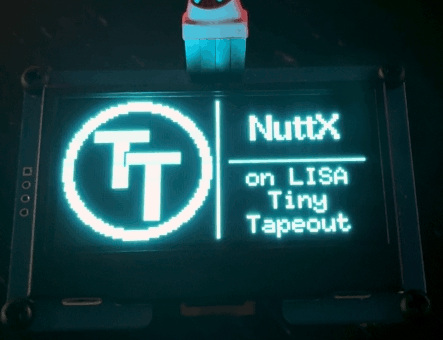

After a change in the code sizes the per-file bank map is regenerated and the objects rebuilt
(`arch/lisa/src/tools/banks_pack.py > boards/lisa/lisa/arty/scripts/banks.map`, then a clean build); the
board's `README.md` in the nuttx tree describes the port - the register frame, the context switch, the
interrupt entry, the heap regions - in detail.

## How to test

The Software section above has the toolchain: `sdcc -mlisa --rev3` builds a program, `lisa_sim --rev3` runs it on
the host, and `lisa_ide` or LISA Commander program it into the demo board's flash through the debug UART and
debug it there.  `test/` in the repository is the cocotb testbench (`make` runs the default test, `make TTLC=1`,
`make WS2812=1` and the others the peripheral tests; `test/run_suite.sh chip REV3=1` the compiler's suite on the
RTL; `make GATES=yes` the same on the hardened netlist).

\clearpage
### Legend for Pinout

The figure shows the pins in each of the four uo_out mux modes (Debug register 0x1B, two bits per pin) with
the uio pins in the matching io mux mode (Debug register 0x1C, two bits per pin; the two registers are
independent, so any uo mode goes with any uio mode).  The debug UART's pins (rx and tx, or rx2 / rx3 with tx
on uio[5]) are taken by the UART in every mode once the autobaud has picked them.

  - pa: LISA GPIO Port A input (ui_in, readable in every mode)
  - pb: LISA GPIO Port B output (uo_out mux 1)
  - b_div: Debug UART baud divisor sampled at reset
  - b_set: Debug UART baud divisor enable (HIGH) sampled at reset
  - baud_clk: the debug UART's baud rate reference, 16 rising edges per bit (uo[0] in mux 0)
  - rx / tx: the debug UART on the RP2040 UART pins (ui_in[3] / uo[4]); rx2 (uio[6]) and rx3 (uio[4]) its
    other RX choices, both with tx on uio[5]
  - io[1..3]: uo[1] - uo[3] in mux 0 echo uio[1] - uio[3]; "0" marks a pin driven low
  - ce0 / ce1: the QSPI chip selects; sclk the QSPI clock
  - sio0/1/2/3: the QSPI bidirectional data lines (sio0 is MOSI and sio1 MISO in single SPI)
  - ce_latch: Latch enable for Special Mux Mode 3 as described above
  - ce0_latch: CE0 output during Special Mux Mode 3 
  - ce1_latch: CE1 output during Special Mux Mode 3 
  - pc_io: LISA GPIO Port C I/O (direction controllable by LISA; io mux mode 1)
  - scl / sda: the I2C master (io mux mode 0 on uio[6] / uio[7], mode 2 on uio[4] / uio[5])
  - tx2 / rx2: UART2 (uo mux 2; its RX is the ui_in pin of the first of uo[0..2] in mux 2); de: its RS-485
    direction on uo[7] in mux 2 while UART2_CTRL's DE_EN is set (tx2 otherwise)
  - hsc: the two high-speed counters take any pair of ui_in pins, chosen in their CTRL
  - spi_sclk / spi_mosi / spi_cs0 / spi_cs1: the SPI master on its own pins (uo mux 2; cs1 also in mux 0);
    miso its input (ui_in[0], [1], [2] or [7], chosen in SPI CTRL)
  - m3_sclk / m3_mosi / m3_cs0 / m3_cs1: the SPI master on the TTLC's pins (mux mode 3)
  - ttlc_d0/1/2: TTLC shift register output data; ttlc_in0/1/2 the chain inputs (ui_in[4] - ui_in[6])
  - ttlc_latch / ttlc_shclk: the TTLC's shift register latch (uo[5]) and shift clock (uo[6])
  - ttlc_reset: the TTLC's reset output to the shift registers (uo[3] in mux 3)
  - pwm0 / pwm1: Timer 3's PWM outputs (mux 2, when enabled in T3 CTRL; else tx2)
  - t3_cap0 / t3_cap1: Timer 3's input capture pins
  - ws: the WS2812B driver's line (mux 3, the one selected in WS_CTRL; the others held low)

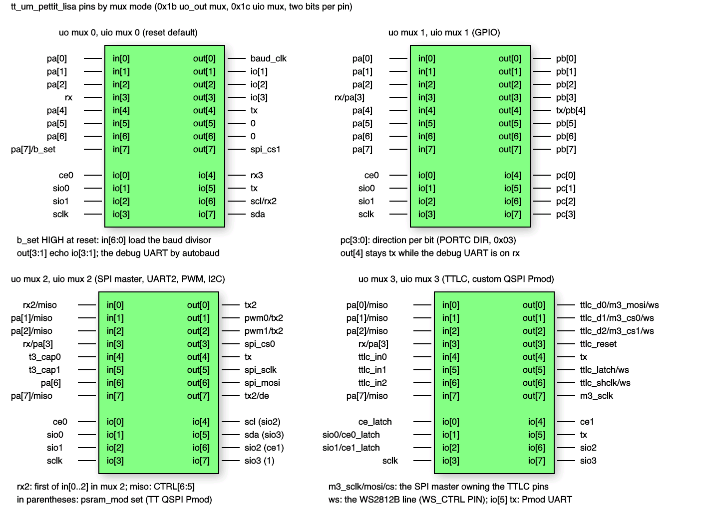
