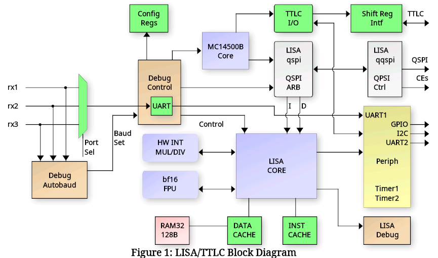
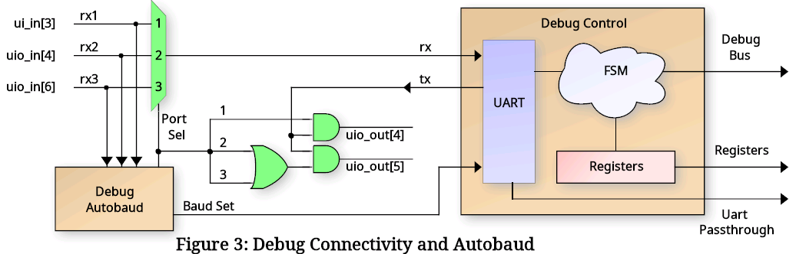
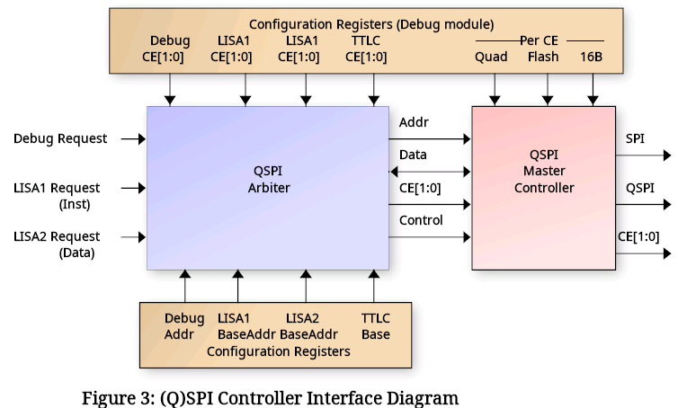
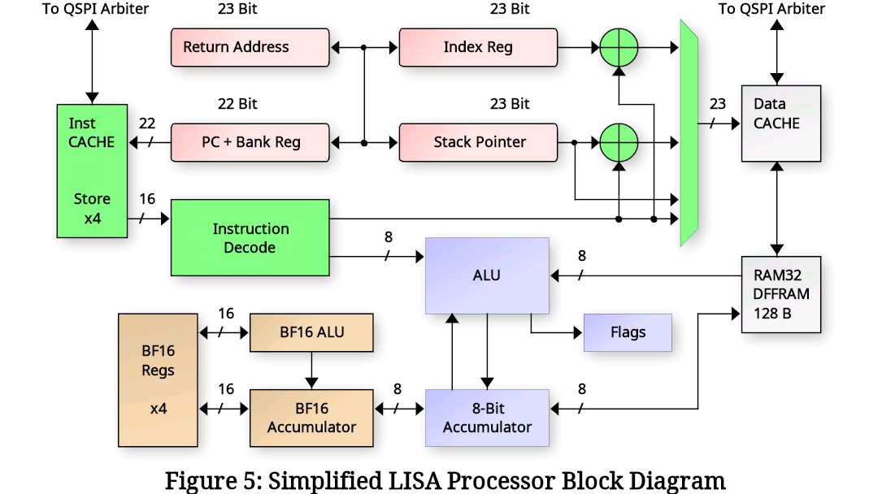
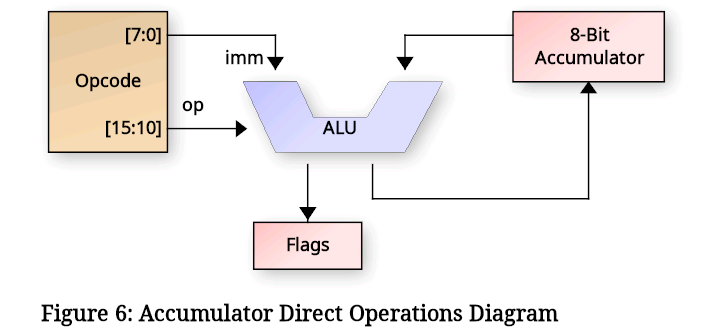
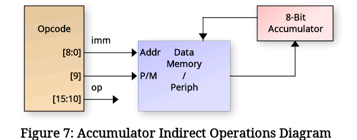
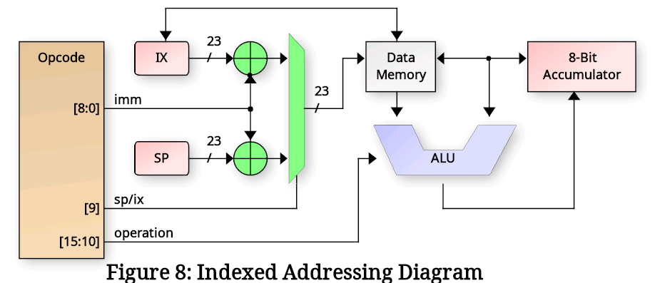
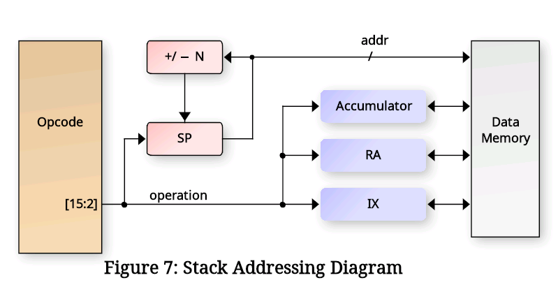
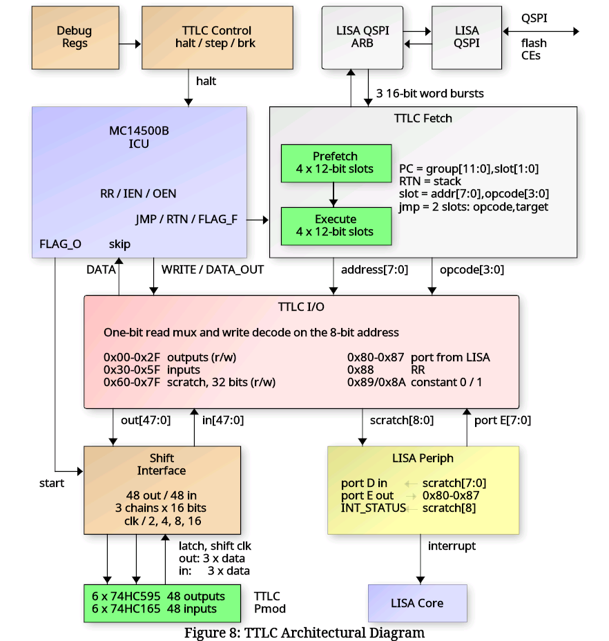

## What is LISA with TTLC?

LISA is a Microcontroller built around a custom 8-Bit Little ISA (LISA)
microprocessor core.  It includes several standard peripherals that
would be found on commercial microcontrollers including timers, GPIO,
UARTs and I2C. TTLC is a Programmable Logic Controller for Tiny Tapeout
(TTLC) build around a functional equivalent of a Motorola mc1500b system
controller.
The following is a block diagram of the design:



   - The LISA Core has a minimal set of registers that allow it to run C programs:
      - Program Counter + Return Address Resister
      - Stack Pointer and Index Register (Indexed DATA RAM access)
      - 8-bit Accumulator + 16-bit BF16 Accumulator and 4 BF16 registers
      - Flag bits and ALU mode register
      - BF16 Floating point registers
      - Interrupt control bits

### Deailed list of the features
   - Harvard architecture LISA Core (16-bit instruction, 22-bit address space)
   - Motorola MC14500B System Controller with PC, Stack, I/O and stroage
   - Debug interface
      * UART controlled
      * Auto detects port from one of 3 interfaces
      * Auto detects the baud rate
      * Interfaces with SPI / QSPI SRAM or FLASH
      * Can erase / program the (Q)SPI FLASH
      * Read/write LISA core registers and peripherals
      * Set LISA breakpoints, halt, resume, single step, etc.
      * SPI/QSPI programmability (single/quad, port location, CE selects)
   - (Q)SPI Arbiter with 4 access channels
      * Debug interface for direct memory access
      * Instruction fetch (LISA and MC14500B)
      * Data fetch
      * Quad or Single SPI.  Hereafter called QSPI, but supports either.
   - Onboard 128 Byte RAM for DATA / DATA CACHE
   - Data bus CACHE controller with 8 16-byte CACHE lines
   - Streaming QSPI instruction fetch controller
   - Instruction CACHE with a single 8-instruction CACHE line for small loops
   - Two 16-bit programmable timers (with pre-divide)
   - Timer 3: a 16-bit timer with two PWM outputs and two input captures
   - WS2812B (NeoPixel) LED string driver on up to five pins, using the TTLC's output flops as its pixel buffer
   - Debug UART available to LISA core also
   - Dedicated UART2 that is not shared with the debug interface
   - 8-bit Input port (PORTA)
   - 8-bit Output port (PORTB)
   - 4-bit BIDIR port (PORTC)
   - I2C Master controller
   - SPI Master controller (two chip selects, its own pins or shared with the TTLC's)
   - Hardware 8x8 integer multiplier
   - Hardware 16/8 or 16/16 integer divider
   - Hardware Brain Float 16 (BF16) Multiply/Divide/Add/Negate/ItoF/FtoI
   - Programmable I/O mux for maximum flexibility of I/O usage.
   - TTLC 48-Outputs plus 48-Inputs via external 74HC595 / 74HC165 chips
   - TTLC 64-Bit internal storage plus 16 bit I/O to LISA (8 each direction)
   - TTLC I/O readable / writable by LISA as bytes, with LISA-started I/O scans

A 32x32 1RW [DFFRAM](https://github.com/AUCOHL/DFFRAM) macro implements a 128 byte RAM module.
The RAM can be used either as a DATA cache for the processor, giving a 32K Byte address range,
or the CACHE controller can be disabled, connecting the Lisa processor core to the RAM directly, limiting the 
data space to 128 bytes.

## Connectivity

All communication with the design is done through a UART connected to the Debug Controller.  The UART
I/O pins are auto-detected by the debug_autobaud module from the following choices (RX/TX):

    ui_in[3]  / ui_out[4]     RP2040 UART interface   
    uio_in[4] / uio_out[5]    LISA PMOD board (I am developing)
    uio_in[6] / uio_out[5]    Standard UART PMOD



The RX/TX pair port is auto-detected after reset by the autobaud circuit, and the UART baud rate can either be
configured manually or auto detected by the autobaud module.  After reset, the ui_in[7] pin is sampled to determine
the baud rate selection mode.  If this input pin is HIGH, then autobaud is disabled and ui_in[6:0] is sampled as
the UART baud divider and written to the Baud Rate Generator (BRG).  The value of this divider should be: clk_freq / baud_rate / 8 - 1.
Due to last minute additions of complex floating point operations, and only 2 hours left on the count-down clock, the timing
was relaxed to 20MHz input clock max.  So for a 20MHz clock and 115200 baud, the b_div[6:0] value would be 42 (for instance).

If the ui_in[7] pin is sampled LOW, then the autobaud module will monitor all three potential RX input pins for LINEFEED
(ASCII 0x0A) code to detect baud rate and set the b_div value automatially.  It monitors bit transistions and searches for three
successive bits with the same bit period.  Since ASCII code 0x0A contains a "0 1 0 1 0" bit sequence, the baud rate can be detected easily.

Regardless if the baud rate is set manually or using autobaud, the input port selection will be detect automatically 
by the autobaud.  In the case of manual buad rate selection, it simply looks for the first transition on any of the
three RX pins.  For autobaud, it selects the RX line with three successive equivalent bit periods.

### Debug Interface Details

The Debug interface uses a fixed, Verilog coded Finite State Machine (FSM) that supports a set of commands over
the UART to interface with the microcontroller.  These commands are simple ASCII format such that low-level testing
can be performed using any standard terminal software (such as minicom, tio. Putty, etc.).  The 'r' and 'w' commands must be
terminated using a NEWLINE (0x0A) with an optional CR (0x0D).  Responses from the debug interface are always 
terminated with a LINFEED plus CR sequence (0x0A, 0x0D).  All HEX values must be lower case.

 | Command   | Description                                                          |
 | --------- | -------------------------------------------------------------------- |
 | v         | Report Debugger version.  Should return: lisav1.2                    |
 | wAAVVVV   | Write 16-bit HEX value 'VVVV' to register at 8-bit HEX address 'AA'. |
 | rAA       | Read 16-bit register value from 8-bit HEX address 'AA'.              |
 | t         | Reset the LISA core.                                                 |
 | l         | Grant LISA the UART.  Further data will be ignored by the debugger.  |
 | +++       | Revoke LISA UART.  NOTE: a 0.5s guard time before/after is required. |

### Debug Configuration and Control Registers

The following table describes the configuration and LISA debug register addresses available via the debug 'r' and 'w'
commands.  The individual register details will be described in the sections to follow.

 | ADDR | Description                  | ADDR | Description                  |
 | ---- | --------------------------   | ---- | ---------------------------- |   
|| 0x00 | LISA Core Run Control        | 0x19 | QSPI Write CMD value         |                                           
 | 0x01 | LISA Accumulator / FLAGS     | 0x1a | The '+++' guard time count   |   
 | 0x02 | LISA Program Counter (PC)    | 0x1b | Mux bits for uo_out          |   
 | 0x03 | LISA Stack Pointer (SP) LSW  | 0x1c | UIO mux, clk_div, psram_mod  |   
 | 0x04 | LISA Return Address (RA) LSW | 0x1d | CACHE control                |   
 | 0x05 | LISA Index Register (IX) LSW | 0x1e | QSPI edge / SCLK speed       |   
 | 0x06 | LISA Data bus                | 0x1f | MC14500b Base Address        |   
 | 0x07 | LISA Data bus address LSW    | 0x20 | Debug QSPI Read / Write      |   
 | 0x08 | LISA Breakpoint 1            | 0x21 | Debug QSPI custom command    |   
 | 0x09 | LISA Breakpoint 2            | 0x22 | Debug read SPI status reg    |   
 | 0x0a | LISA Breakpoint 3            | 0x30 | Floating point reg f0        |   
 | 0x0b | LISA Breakpoint 4            | 0x31 | Floating point reg f1        |   
 | 0x0c | LISA Breakpoint 5            | 0x32 | Floating point reg f2        |   
 | 0x0d | LISA Breakpoint 6            | 0x33 | Floating point reg f3        |   
 | 0x0f | LISA Current Opcode Value    | 0x34 | Floating point reg facc      |     
 | 0x10 | Debug QSPI Address (LSB16)   | 0x38 | LISA IX_COND, IX MSB         |     
 | 0x11 | Debug QSPI Address (MSB8)    | 0x39 | LISA SP MSB                  |     
 | 0x12 | LISA1 QSPI base address      | 0x3a | LISA RX_COND, RA MSB         |     
 | 0x13 | LISA2 QSPI base address      | 0x3c | LISA Data bus addr MSB       |     
 | 0x14 | LISA1 QSPI CE select         | 0x40 | MC14500B Run Control         |     
 | 0x15 | LISA2 QSPI CE select         | 0x41 | MC14500B Program Counter     |     
 | 0x16 | Debug QSPI CE select         | 0x48 | MC14500B Breakpoint 1        |     
 | 0x17 | QSPI Mode (QUAD, flash, 16b) | 0x49 | MC14500B Breakpoint 2        |     
 | 0x18 | QSPI Dummy read cycles       | 0x4a | MC14500B Breakpoint 3        |     
                                                                                   
### LISA Processor Interface Details                                         

The LISA Core requires external memory for all Instructions and Data.  To accomodate external memory,
the design uses a QSPI controller that is configurable as either single SPI or
QUAD SPI, Flash or SRAM access, 16-Bit or 24-Bit addressing, and selectable Chip Enable for each
type of access.  To achieve this, a QSPI arbiter is used to allow multiple accessors as shown in
the following diagram:



The arbiter is controlled via configuration registers (accessible by the Debug controller)
that specify the operating mode per CE, and CE selection bits for each of the three interfaces:

   - Debug Interface
   - LISA1 (Instruction fetch)
   - LISA2 (Data read/write)
   - MC14550B (Instruction fetch)

The arbiter gives priority to the Debug accesses and processes LISA1 and LISA2 requests using
a round-robbin approach.  Each requestor provides a 24-bit address along with 16-bit data read/write.
For the Debug interface, the address comes from the configuration registers directly.  For LISA1,
the address is the Program Counter (PC) + LISA1 Base and for LISA2, it is the Data Bus address +
LISA2 Base.  The LISA1 and LISA2 base addresses are programmed by the Debug controller and set the 
upper 16-bits in the 24-bit address range.  The PC and Data address provide the lower 16 bis (8-bits
overlapped that are 'OR'ed together).  The BASE addresses allow use of a single external QSPI SRAM
for both instruction and data without needing to worry about data collisions.

When the arbiter chooses a requestor, it passes its programmed CE selection to the QSPI controller.  The
QSPI controller then uses the programmed QUAD, MODE, FLASH and 16B settings for the chosen CE to process the
request.  This allows LISA1 (Instruction) to either execute from the same SRAM as LISA2 (Data) or to
execute from a separate CE (such as FLASH with permanent data storage).

Additionally the Debug interface has special access registers in the 0x20 - 0x22 range that allow 
special QSPI accesses such as FLASH erase and program, SRAM programming, FLASH status read, etc.  In
fact the Debug controller can send any arbitrary command to a target device, using access that either
provide an associated address (such as erase sector) or no address.  The proceedure for this is:

  1.  Program Debug register 0x19 with the special 8-bit command to be sent
  2.  Set the 9-th bit (reg19[8]) to 1 if a 16/24 bit address needs to be sent)
  3.  Perform a read / write operation to debug address 0x21 to perform the action.

Simple QSPI data reads/write are accomplished via the Debug interface by setting the desired address
in Debug config register 0x10 and 0x11, then performing read or write to address 0x20 to perform the request.
Reading from Debug config register 0x22 will perform a special mode read of QSPI register 0x05 (the FLASH
status register).

Data access to the QSPI arbiter come from the Data CACHE interface (described later), enabling a 32K address
space for data.  However the design has a CACHE disable mode that directs all Data accesses directly to the
internal 128 Byte RAM, thus eliminating the need for external SRAM (and limiting the data bus to 128 bytes).

### Programming the QSPI Controller

Before the LISA microcontroller can be used in any meaningful manner, a SPI / QSPI SRAM (and optionally a NOR FLASH) must
be connected to the Tiny Tapeout PCB.  Alternately, the RP2040 controller on the board can be configured to emulate a
single SPI (the details for configuring this are outside the scope of this documentation ... search the Tiny Tapeout
website for details.).  For the CE signals, there are two operating modes, fixed CE output and Mux Mode 3 "latched" CE
mode.  Both will be described here.  The other standard SPI signals are routed to dedicated pins as follows:

 | Pin    | SPI   | QSPI | Notes                            |
 | ------ | ----- | ---- | -------------------------------- |
 | uio[0] | CE0   | CE0  |                                  |
 | uio[1] | MOSI  | DQ0  | Also MOSI prior to QUAD mode DQ0 |
 | uio[2] | MISO  | DQ1  | Also MISO prior to QUAD mode DQ1 |
 | uio[3] | SCLK  | SCLK |                                  |
 | uio[4] | CE1   | CE1  | Must be enabled via uio MUX bits |
 | uio[6] |  -    | DQ2  | Must be enabled via uio MUX bits |
 | uio[7] |  -    | DQ3  | Must be enabled via uio MUX bits |

For Special Mux Mode 3 (Debug register 0x1C uio_mux[7:6] = 2'h3), the pinout is mostly the same except the CE signals are not constant.
Instead they are "latched" into an external 7475 type latch.  This mode is to support a PMOD board connected to the uio
PMOD which supports a QSPI Flash chip, a QSPI SRAM chip, and either Debug UART or I2C.  For all of that functionality, 
nine pins would be required for continuous CE0/CE1, however only eight are available.  So the external PMOD uses uio[0] as a
CE "latch" signal and the CE0/CE1 signals are provided on uio[1]/uio[2] during the latch event.  This requires a series
resistor as indicated to allow CE updates if the FLASH/SRAM is driving DQ0/DQ1.  The pinout then becomes:

 | Pin    | SPI/QSPI           | Notes                                        |
 | ------ | ------------------ | -------------------------------------------- |
 | uio[0] | ce_latch           | ce_latch HIGH at beginning of cycle          |
 | uio[1] | ce0_latch/MOSI/DQ0 | Connection to FLASH/SRAM via series resistor |
 | uio[2] | ce1_latch/MISO/DQ1 | Connection to FLASH/SRAM via series resistor |
 | uio[3] | SCLK               |                                              |
 | uio[6] | -/DQ2              | Must be enabled via uio MUX bits             |
 | uio[7] | -/DQ3              | Must be enabled via uio MUX bits             |

This leaves uio[4]/uio[5] available for use as either UART or I2C.

There is also a QSPI PSRAM PMOD mode that maps the QSPI signals to be compatible with the standard Tiny Tapeout
PMOD.  In that mode (enabled using the psram_mod bit), the pinout becomes:

 | Pin    | SPI   | QSPI | Notes                            |
 | ------ | ----- | ---- | -------------------------------- |
 | uio[0] | CE0   | CE0  | Chip Select for flash            |
 | uio[1] | MOSI  | DQ0  | Also MOSI prior to QUAD mode DQ0 |
 | uio[2] | MISO  | DQ1  | Also MISO prior to QUAD mode DQ1 |
 | uio[3] | SCLK  | SCLK |                                  |
 | uio[4] |  -    | DQ2  | QUAD mode DQ2                    |
 | uio[5] |  -    | DQ3  | QUAD mode DQ3                    |
 | uio[6] | CE1   | CE1  | Chip Select for PSRAM A          |
 | uio[7] |  1    | 1    | Chip Select for PSRAM B (unused) |

Once the SPI/QSPI SRAM and optional FLASH have been chosen and connected, the Debug configuration registers must
be programmed to indicate the nature of the external device(s).  This is accompilished using Debug registers 0x12 - 0x19 and
0x1C.  To programming the proper mode, follow these steps:

   1. Program the LISA1, LISA2, TTLC and Debug CE Select registers (0x14, 0x15, 0x16) indicating which CE to use.
      -  0x14, 0x16:  {14'h0, ce1_en, ce0_en} Active HIGH
      -  0x15: {12'h0, ttlc_ce1_en, ttlc_ce0_en, lisa2_ce1_en, lisa2_ce0_en}
   2. Program the LISA1,LISA2 and TTLC base addresses if they use the same SRAM:
      -  0x12: {LISA1_BASE, 8'h0} | {8'h0, PC}
      -  0x13: {LISA2_BASE, 8'h0} | {8'h0, DATA_ADDR}
      -  0x1f: {TTLC_BASE, 8'h0}  | {8'h0, MC14500_ADDR}
   3. Program the mode for each Chip Enable (bits active HIGH)
      -  0x17: {10'h0, is_16b[1:0], is_flash[1:0], is_quad[1:0]}
   4. For Quad SPI, Special Mux Mode 3, or CE1, program the uio_mux mode:
      -  0x1C:
         * [7:6] = 2'h2: Normal QSPI DQ2 select
         * [7:6] = 2'h3: Special Mux Mode 3 (Latched CE)
         * [5:4] = 2'h2: Normal QSPI DQ3 select
         * [5:4] = 2'h3: Special Mux Mode 3
         * [1:0] = 2'h2: CE1 select on uio[4]
   5. For RP2040, you might need to slow down the SPI clock / delay between successive CE activations:
      -  0x1E:
         * [3:0] spi_clk_div: Number of clocks SCLK HIGH and LOW
         * [10:4] ce_delay: Number clocks between CE activations
         * [12:11] spi_mode: Per-CE FALLING SCLK edge data update
         * [14:13] spi_rd_late: Per-CE read data captured on the FALLING SCLK edge
           after the rising one (outgoing data unchanged) - for clk/2 (div 0), where
           the round trip through the pads and the part leaves too little of the
           half period; 0x6010 = clk/2 with it on both CEs
   6. Set the number of DUMMY ready required for each CE:
      -  0x18: {8'h0, dummy1[3:0], dummy0[3:0]
   7. For QSPI FLASH, set the QSPI Write opcode (it is different for various Flashes):
      -  0x19: {8'h0, quad_write_cmd}

NOTE: For register 0x1E (SPI Clock Div and CE Delay), there is only a single register, meaning this
      register value applies to both CE outputs.  Delaying the clock of one CE will delay both,
      and adding delay between CE activations does not keep track of which CE was activated.
      So if two CE outputs are used and a CE delay is programmed, it will enforce that delay
      even if a different CE is used.  This setting is really in place for use when the RP2040
      emulation is being used in a single CE SRAM mode only (i.e. you have no external PMOD
      with a real SRAM / FLASH chip.  In the case of real chips on a PMOD, SCLK and CE delays
      (most likely) are not needed.  The Tech Page on the Tiny Tapeout regarding RP2040 SPI SRAM
      emulation indicates a delay between CE activations is likely needed, so this setting is 
      provided in case it is needed.

## LISA Architecture Details

Below is a simplified block diagram of the LISA processor core.  It uses an 8-bit accumulator for most of
its operations with the 2nd argument predominately coming from either immediate data in the instruction
word or from a memory location addressed by either the Stack Pointer (SP) or Index Register (IX).

There are also instructions that work on the 15-bit registers PC, SP, IX and RA (Return Address).  As
well as floating point operations. These will be covered in the sections to follow.



### Addressing Modes

Like most processors, LISA has a few different addressing modes to get data in and out of the core.  These
include the following:

 | Mode     | Data                 | Description                                       |
 | -------- | -------------------- | ------------------------------------------------- |
 | Register | Rx[n -: 8]           | Transfers between registers (ix, ra, facc, etc.). |
 | Direct   | inst[n:0]            | N-bit data stored in the instruction word.        |
 | NextOp   | (inst+1)[14:0]       | Data stored in the NEXT instruction word.         |
 | Indirect | mem[inst[n:0]]       | Address of the data is in the instruction word.   |
 | Periph   | periph[inst[n:0]]    | Accesses to the peripheral bus.                   |
 | Indexed  | mem[sp/ix+inst[n:0]] | The SP or IX register is added to a fixed offset. |
 | Stack    | mem[sp]              | Stack pointer points to the data (push/pop).      |

### The Control Registers

To run meaninful programs, the Program Counter (PC) and Stack Pointer (SP) must
be set to useful values for accessing program instructions and data.  The PC is automatically reset
to zero by rst_n, so that one is pretty much automatic.  All programs start at address zero (plus 
any base address programmed by the Debug Controller). But as far as the LISA core is concerned, it
knows nothing of base addresses and believes it is starting at address zero.

Next is to program the SP to point to a useful location in memory.  The Stack is a place where C 
programs store their local variable values and also where we store the Return Address (RA) if we need
to call nested routines, etc.  The stack grows down, meaning it starts at a high
RAM address and decrements as things are added to the stack.  Therefore the SP should be programmed
with an address in upper RAM.  LISA supports different Data bus modes through it's CACHE controller,
including CACHE disable where it can only access 128 bytes.  But for this example, let's assume we have
a full range of 32K SRAM available.  The LISA ISA doesn't have an opcode for loading the SP directly.
Instead it can load the IX register directly with a 15-bit value using NextOp addressing, and it
supports "xchg" opcodes to exchange the IX register with either the SP or RA.
So to load the SP, we would write:

    Example:
      ldx     0x7FFF      // Load IX with value in next opcode
      xchg_sp             // Exchange IX with SP

The IX register can be programmed as needed to access other data within the Data Bus address range. This
register is useful especially for accessing structures via a C pointer.  The IX then becomes the value
of the pointer to RAM, and Indexed addressing mode allows fixed offsets from that pointer (i.e. structure
elements) to be accessed for read/write.

Loading the PC indirectly can be done using the "jmp ix" opcode which does the operation pc <= ix.  Loading
ix from the pc directly is not supported, though this can be accomplished using a function call and opcodes 
to save RA (sra) and pop ix:

     Example:
       get_pc:
         sra         // Push RA to the stack (Save RA)
         pop_ix      // Pop IX from the stack
         ret         // Return. Upon return, IX is the same as PC

### Conditional Flow Processing

Program flow is controlled using flags (zero, carry, sign), arithemetic mode (amode) and condition
flags (cond) to determine when program branches should occur.  Specific opcode update the flags and
condition registers based on results of the operation (AND, OR, IF, etc.).  Then conditional branches
are made using bz, bnz and if (and variants ifte "if-then-else" and iftt "if-then-then").  Also 
available are rc "Return if Carry" and rz "Return if Zero", though these are less useful in C programs
as typically a routine uses local variables and the stack must be restored prior to return, mandating
a branch to the function epilog to restore the stack and often the return address.  Below is a list
of the opcodes used for conditional program processing:

Legend for operations below:

 - acc_val = inst[7:0]
 - pc_jmp = inst[14:0]
 - pc_rel = pc + sign_extend(inst[10:0])

 | Opcode  | Operation      | Encoding            | Description               |
 | ------- | -------------- | ------------------- | ------------------------- |
 | jal     | pc <= pc_jmp   | 0aaa_aaaa_aaaa_aaaa | Jump And Link (call).     |
 |         | ra <= pc       |                     |                           |
 | ret     | pc <= ra       | 1000_1010_0xxx_xxxx | Return                    |
 | rets    | pc <= ia,ie<=1 | 1000_1011_01xx_xxxx | Return from ISR           |
 | reti    | pc <= ra       | 1000_11xx_iiii_iiii | Return Immediate.         |
 |         | acc <= acc_val |                     |                           |
 | br      | pc <= pc_rel   | 1011_0rrr_rrrr_rrrr | Branch Always             |
 | bz      | pc <= pc_rel   | 1011_1rrr_rrrr_rrrr | Branch if Zero.           |
 |         | if zero=1      |                     |                           |
 | bnz     | pc <= pc_rel   | 1010_1rrr_rrrr_rrrr | Branch if Not Zero.       |
 |         | if zero=0      |                     |                           |
 | rc      | pc <= ra       | 1000_1011_00xx_xxxx | Return if Carry           |
 |         | if carry=1     |                     |                           |
 | rz      | pc <= ra       | 1000_1011_10xx_xxxx | Return if Zero            |
 |         | if zero=1      |                     |                           |
 | call_ix | pc <= ix       | 1000_1010_100x_xxxx | Call indirect via IX      |
 |         | ra <= pc       |                     |                           |
 | jump_ix | pc <= ix       | 1000_1010_101x_xxxx | Jump indirect via IX      |
 | if      | cond <= ??     | 1010_0010_0000_0ccc | If.  See below.           |
 | iftt    | cond <= ??     | 1010_0010_0000_1ccc | If then-then.  See below. |
 | ifte    | cond <= ??     | 1010_0010_0001_0ccc | If then-else.  See below. |

### The IF Opcode

The "if" opcode and it's variants "if-then-then" and "if-then-else" control program flow in a slightly
different manner than the others.  Instead of affecting the value of the PC directly, they set the two
condition bits "cond[1:0]" to indicate which (if any) of the two following opcodes should be executed.
the cond[0] bit represents the next instruction and cond[1] represents the instruction following that. All
three "if" forms take an argument that checks the current value of the FLAGS to set the condition bits.  The
argument is encoded as the lower three bits of the instruction word ard operate as shown in the following table:

 | Condition | Test              | Encoding | Description                      |
 | --------- | ----------------- | -------- | -------------------------------- |
 | EQ        | zflag=1           | 3'h0     | Execute if Equal                 |
 | NE        | zflag=0           | 3'h1     | Execute if Not Equal             |
 | NC        | cflag=0           | 3'h2     | Execute if Not Carry             |
 | C         | cflag=1           | 3'h3     | Execute if Carry                 |
 | GT        | ~cSigned & ~zflag | 3'h4     | Execute if Greater Than          |
 | LT        | cSigned & ~zflag  | 3'h5     | Execute if Less Than             |
 | GTE       | ~cSigned | zflag  | 3'h6     | Execute if Greater Than or Equal |
 | LTE       | cSigned | zflag   | 3'h7     | Execute if Less Than or Equal    |

The "if" opcode will set cond[0] based on the condition above and the cond[1] bit to HIGH.  It only affects
the single instruction following the "if" opcode.  The "iftt" opcode will set both cond[0] and cond[1] to the
same value based on the condition above.  It means "if true, execute the next two opcodes".  And the "ifte"
opcode will set cond[0] based on the condition above and cond[1] to the OPPOSITE value, meaning it will execute
either the following instruction OR the one after that (then-else).

    Example:
      ldi      0x41        // Load A immediate with ASCII 'A'
      cpi      0x42        // Compare A immediate with ASCII 'B'
      ifte     eq          // Test if the compare was "Equal"
      jal      L_equal     // Jump if equal
      jal      L_different // Jump if different

The above code will load the "jal L_equal" opcode but will not execute it since the compare was Not Equal.
Then it will execute the "jal L_different" opcode.  Note that if the compare were "ifte ne", it would
call the L_equal function and then upon return would not execute the "L_different" opcode.  This is because 
the cond[1] code is saved with the Return Address (RA) during the call and restored upon return.  This means
the FALSE cond[1] code would prevent the 2nd opcode from executing.  As an opcode gets executed, the cond[1]
value is shifted into the cond[0] location, and the cond[1] is loaded with 1'b1.

### Direct Operations

To do any useful work, the LISA core must be able to load and operate on data.  This is done through the
accumulator using the various addressing modes.  The diagram below details the Direct addressing mode where
data is stored directly in the opcode / instruction word:


\clearpage
The instructions that use direct addressing are:

 | Opcode | Operation        | Encoding            | Description               |
 | ------ | ---------------- | ------------------- | ------------------------- |
 | adc    | A <= A + imm + C | 1001_00xx_iiii_iiii | ADD immediate with Carry  |
 | ads    | SP <= SP + imm   | 1001_01ii_iiii_iiii | ADD SP + signed immediate |
 | adx    | IX <= IX + imm   | 1001_10ii_iiii_iiii | ADD IX + signed immediate |
 | andi   | A <= A & imm     | 1000_01xx_iiii_iiii | AND immediate with A      |
 | cpi    | Z,C <= A >= imm  | 1010_01xx_iiii_iiii | Compare A >= immediate    |
 | ldi    | Z,C <= A         | 1000_00xx_iiii_iiii | A = imm C = 0, Z = a==imm |

### Accumulator Indirect / Peripheral Operations

The Accumulator Indirect operations use immediate data in the instruction word to index
indirectly into Data memory or peripheral space.  That memory address is then used to load, store or both
load and store (swap) data with the accumulator.



 | Opcode | Operation   | Encoding            | Description                   |
 | ------ | ----------- | ------------------- | ----------------------------- |
 | lda    | A <= M[imm] | 1111_01pi_iiii_iiii | Load A from Memory/Peripheral |
 | sta    | M[imm] <= A | 1111_11pi_iiii_iiii | Store A to Memory/Peripheral  |
 | swapi  | A <= M[imm] | 1101_11pi_iiii_iiii | Swap Memory/Peripheral with A |
 |        | M[imm] <= A |                     |                               |

 - p = Select Peripheral (1'b1) or RAM (1'b0)
 - iiii = Immediate data

### Indexed Operations

Indexed operations use either the IX or SP register plus a fixed offset from the immediate field of the 
opcode.  The selection to use IX vs SP is also from the opcode[9] bit.  The immediate field is not
sign extended, so only positive direction indexing is supported.  This was selected because this mode
is typically used to access either local variables (when using SP) or C struct members (when using IX), 
and in both cases, negative index offsets aren't very useful.  The following is a diagram of indexed addressing:



 | Opcode | Operation       | Encoding            | Description                         |
 | ------ | --------------- | ------------------- | ----------------------------------- |
 | add    | A <= A+ M[ind]  | 1100_00si_iiii_iiii | ADD index memory to A               |
 | and    | A <= A & M[ind] | 1101_00si_iiii_iiii | AND A with index memory             |
 | cmp    | A >= M[ind]?    | 1110_10si_iiii_iiii | Compare A with index memory         |
 | dcx    | M[ind] -= 1     | 1001_11si_iiii_iiii | Decrement the value at index memory |
 | inx    | M[ind] += 1     | 1110_01si_iiii_iiii | Increment the value at index memory |
 | ldax   | A <= M[ind]     | 1111_00si_iiii_iiii | Load A from index memory            |
 | ldxx   | IX <= M[SP+imm] | 1100_110i_iiii_iiii | Load IX from memory at SP+imm       |
 | mul    | A <= A*M[ind]L  | 1100_10si_iiii_iiii | Multiply index memory * A, keep LSB |
 | mulu   | A <= A*M[ind]H  | 1000_01si_iiii_iiii | Multiply index memory * A, keep MSB |
 | or     | A <= A | M[ind] | 1101_10si_iiii_iiii | OR A with index memory              |
 | stax   | M[ind] <= A     | 1111_10si_iiii_iiii | Store A to index memory             |
 | stxx   | M[SP+imm] <= IX | 1100_111i_iiii_iiii | Save IX to memory at SP+imm         |
 | sub    | A <= A-M[ind]   | 1100_10si_iiii_iiii | SUBtract index memory from A        |
 | swap   | A <= M[ind]     | 1110_11si_iiii_iiii | Swap A with index memory            |
 |        | M[ind] <= A     |                     |                                     |
 | xor    | A <= A ^ M[ind] | 1110_00si_iiii_iiii | XOR A with index memory             |

\clearpage
Legend for table above:

 - ind = IX or SP + immediate
 - s = Select IX (zero) or SP (one)
 - iiii = Immediate data

The Zero and Carry flags are updated for most of the above operations.  The Carry flag is only updated for math operations where a Carry / Borrow could occur.

 | Carry | Zero        |
 | ----- | ----------- |
 | adc   | add    and  |
 | add   | or     xor  |
 | sub   | cmp    sub  |
 | cmp   | dcx    inx  |    
 | dcx   | swap   ldax |
 | inx   | mul    mulu |

### Stack Operations

Stack operations use the current value of the SP register to PUSH and POP items to the stack in
opcode.  As items are PUSHed to the stack, the SP is decremented after each byte, and as they
are POPed, the SP is incremented prior to reading from RAM.



 | Opcode  | Operation     | Encoding            | Description               |
 | ------- | ------------- | ------------------- | ------------------------- |
 | lra     | RA <= M[SP+1] | 1010_0001_0110_01xx | Load {cond,RA} from stack |
 |         | SP += 2       |                     |                           |
 | sra     | M[SP] <= RA   | 1010_0001_0110_00xx | Save {cond,RA} to stack   |
 |         | SP -= 2       |                     |                           |
 | push_ix | M[SP] <= IX   | 1010_0001_0110_10xx | Save IX to stack          |
 |         | SP -= 2       |                     |                           |
 | pop_ix  | IX <= M[SP+1] | 1010_0001_0110_11xx | Load IX from stack        |
 |         | SP += 2       |                     |                           |
 | push_a  | M[SP] <= A    | 1010_0000_100x_xxxx | Save A to stack           |
 |         | SP -= 1       |                     |                           |
 | pop_a   | A <= M[SP+1]  | 1010_0000_110x_xxxx | Load A from stack         |
 |         | SP += 1       |                     |                           |

### Register and other Operations

Register operations operate exclusively on internal registers, such as exchanging
between two regs, shifting, complimenting, etc.  Also there are a few miscelanous
opcodes for things like setting arithemetic mode, complimenting the C flag, etc.

 | Opcode  | Operation     | Encoding            | Description               |
 | ------- | ------------- | ------------------- | ------------------------- |
 | amode   | amode <= acc  | 1010_0001_0100_0mmm | Load amode from acc[2:0]  |
 | brk     | Breakpoint    | 1010_0000_0111_11xx | Halt the processor        |
 | cpx_ra  | C,Z <= IX>=RA | 1000_1010_1101_00xx | Compare RA with IX        |
 | cpx_sp  | C,Z <= IX>=SP | 1000_1010_1101_10xx | Compare SP with IX        |
 | ldc     | C <= b        | 1010_0000_0000_1bxx | Load C flag from b        |
 | ldirq   | acc <= IRQz,c | 1010_0001_0010_00xx | Load acc with IRQ [z,c]   |
 | ldz     | Z <= b or ~Z  | 1010_0000_0110_cbxx | Z <= ~Z if c else b       |
 | nop     | No operation  | 1010_0000_0111_00xx | Z <= ~Z if c else b       |
 | notz    | Z <= ~Z       | 1010_0000_0111_01xx | Z <= ~Z if c else b       |
 | eidi    | ie <= f       | 1010_0000_0111_10xf | Load Interrupt Enable     |
 | xchg_ia | IA <=> IX     | 1000_1010_1100_01xx | Exchange IA with IX       |
 | xchg_ra | RA <=> IX     | 1000_1010_1100_00xx | Exchange RA with IX       |
 | xchg_sp | SP <=> IX     | 1000_1010_1100_10xx | Exchange SP with IX       |
 | shl     | a <<= 1       | 1010_0000_0000_00xx | Shift acc left 1          |
 | shl16   | a,M[SP] <<= 1 | 1010_0000_0010_iixx | 16-bit shift left 1       |
 | shr     | a >>= 1       | 1010_0000_0000_01xx | Shift acc right 1         |
 | shr16   | a,M[SP] >>= 1 | 1010_0000_0011_iixx | 16-bit shift right 1      |
 | spix    | SP <= IX      | 1000_1010_1100_11xx | Load SP from IX           |
 | stirq   | IRQz,c <= acc | 1010_0001_0010_01xx | Load IRQz,c from acc[1:0] |
 | tax     | IX[L] <= acc  | 1010_0001_0000_00xx | Transfer acc to IX[7:0]   |
 | taxu    | IX[H] <= acc  | 1010_0001_0000_01xx | Transfer acc to IX[14:0]  |
 | txa     | acc <= IX[L]  | 1010_0000_0001_00xx | Transfer IX[7:0] to acc   |
 | txau    | acc <= IX[H]  | 1010_0000_0001_10xx | Transfer IX[14:0] to acc  |

### Floating Point (BF16) Operations

LISA has a small hardware floating point unit that works on Brain Float 16 (BF16) numbers.  BF16 is simply
the upper 16 bits of an IEEE-754 32-bit float ... 1 sign bit, 8 exponent bits and 7 fraction bits.  So it
has the same range as a regular C float (about 1e-38 to 3e38), just with fewer digits of precision (2 to 3
decimal digits), and converting to / from a 32-bit float is just dropping / adding the lower 16 bits.

The FPU has five 16-bit registers:

   - facc: the floating point accumulator.  Every operation leaves its result here.
   - f0 - f3: four floating point registers used as the 2nd operand (selected by the 'ff' bits in the opcode).

There are no load / store opcodes for the floating point registers.  Instead, data gets in and out through
the 8-bit accumulator one byte at a time using 'taf' (A to facc) and 'tfa' (facc to A), and the
f0 - f3 registers are loaded by swapping them with facc using 'fswap'.  So to multiply two numbers
the code loads the first one into facc, swaps it into f0, loads the second into facc and then does the
multiply:

```
    lda    a_lo        ; First operand to f0
    taf    0
    lda    a_hi
    taf    1
    fswap  f0
    lda    b_lo        ; Second operand to facc
    taf    0
    lda    b_hi
    taf    1
    fmul   f0          ; facc <= facc * f0
    tfa    0           ; Read the result back
    sta    r_lo
    tfa    1
    sta    r_hi
```

All of the floating point opcodes are predicated by the cond latch just like the other opcodes, and
they all complete in a single instruction cycle except for 'fdiv', which holds the processor for the
few clocks the divider takes.  The amode register (see 'The Control Registers') controls two things:

   - amode[1]: Selects signed (1) or unsigned (0) 16-bit integers for 'itof' and 'ftoi'.
   - amode[2]: Selects round toward zero (1) or round to nearest even (0) for 'fadd' and 'fdiv'.

 | Opcode  | Operation        | Encoding            | Description                        |
 | ------- | ---------------- | ------------------- | ---------------------------------- |
 | taf     | facc[h] <= A     | 1010_0001_1110_001h | Load half of facc (h=1 upper) from A |
 | tfa     | A <= facc[h]     | 1010_0001_1110_000h | Load A from half of facc (h=1 upper) |
 | fswap   | facc <=> fx      | 1010_0001_1111_00ff | Exchange facc with f0 - f3         |
 | fneg    | fx <= -fx        | 1010_0001_1110_11ff | Negate f0 - f3 (flips the sign bit)|
 | fadd    | facc += fx       | 1010_0001_1110_10ff | Add fx to facc                     |
 | fmul    | facc *= fx       | 1010_0001_1110_01ff | Multiply facc by fx                |
 | fdiv    | facc /= fx       | 1010_0001_1111_10ff | Divide facc by fx, C=1 if valid    |
 | fcmp    | C,Z <= facc ? fx | 1010_0001_1111_01ff | Compare facc with fx               |
 | itof    | facc <= float(facc) | 1010_0011_0010_0000 | Convert 16-bit integer to BF16  |
 | ftoi    | facc <= int(facc)   | 1010_0011_0010_0001 | Convert BF16 to 16-bit integer  |
 | fclr    | facc <= 0        | 1010_0011_0010_0010 | Clear facc                         |

Subtraction is done with 'fneg' followed by 'fadd'.  Note that 'fneg' works on the fx register, not facc, so
the value being subtracted is the one in f0 - f3.  A few details of the individual operations:

   - fadd: Rounds per amode[2] and handles subnormal (denormal) numbers.
   - fmul: Truncates the product (no rounding).  Subnormal inputs and results are flushed to zero.
   - fdiv: Uses a two-step Goldschmidt iteration from a small reciprocal table and rounds per amode[2].  The
     result can be off by one in the last bit now and then.  The C flag is set when the result is valid and
     cleared for the infinity / NaN / divide by zero cases.
   - fcmp: Z is set when the two values have the same bit pattern (so -0 and +0 compare unequal).  C is set
     when facc > fx, with the signs taken into account.  The 'if' opcode can then be used to branch on the result.
   - itof: Converts the 16-bit integer in facc (signed or unsigned per amode[1]), rounding half up.
   - ftoi: Converts facc to a 16-bit integer in facc, truncating toward zero.  Values that are too big
     saturate (65535 unsigned, 32767 / -32768 signed), and a negative value gives 0 in unsigned mode.

To convert an integer, put it in facc with 'taf' (low byte, then high byte), do 'itof' or 'ftoi', and read
the result back with 'tfa'.  The facc and f0 - f3 registers can also be read through the debug interface
(registers 0x30 - 0x34), and they are all cleared to zero at reset.

## The Tiny Tapeout Logic Controller (TTLC)

The second subsystem within this design is a small PLC type circuit.  It is architected around a 1-bit processor from 1977
designed by Motorola ... the MC14500B Industrial Control Unit (ICU).  The TTLC wraps the ICU "processor" with an instruction
fetch pipeline and a bit-level I/O subsystem.



The instruciton fetch pipeline uses 12-bit instructions ... 4 bits for the MC14500B opcode and 8-bits for operand
such as bit address to access, etc.  It uses a 14-bit Program Counter (PC) giving up to 16K instructions.
Since the LISA SPI/QSPI interface is 16-bits wide, the fetch interface pulls 4 12-bit instructions (slots) packed into
3 16-bit words.  For 'jump' instructions, two 12-bit slots are used ... one to specify the opcode and the second
to specify the upper 12 bits of the PC jump location (jump targets must align properly using NOPs).  The "assembler"
takes care of this.

The I/O subsystem uses an 8-bit address and supports the following:

   - 48-Outputs plus 48-Inputs via external 74HC595 / 74HC165 chips
   - 64-Bit internal storage
   - 16 bit I/O to/from LISA (8 each direction)
   - Ability to send interrupt to LISA
   - Constant zero / one bits 

The 8-bit address selects one bit of the I/O space:

 | Address | Contents                                                   |
 | ------- | ---------------------------------------------------------- |
 | 0-47    | Outputs (to the 74HC595 chains)                            |
 | 48-95   | Inputs (from the 74HC165 chains)                           |
 | 96-127  | Internal storage bits 0-31 (bits 0-7 are Port D to LISA, bit 8 interrupts LISA) |
 | 128-135 | The 8 bits from LISA (Port E)                              |
 | 136     | RR (the result register)                                   |
 | 137     | Constant 0                                                 |
 | 138     | Constant 1                                                 |
 | 160-191 | Internal storage bits 32-63                                |

The rest (139-159 and 192-255) read as 0.

The 48-outputs and 48-inputs are managed by a shift-register state machine that interfaces to the external
world using ui_in and uo_out pins.  It implement three parallel 16-bit serial shift busses to external
74HC595 / 74HC165 chips.  This consists of a clock, latch signal, 3 output pins and 3 input pins.
The FSM performs shift and I/O updates when FLAG_O is raised via opcode.  This is also the "return to
address zero" opcode to restart the PLC / TTLC loop.  So the idea is the code loops through the logic
once using current inputs, updates internal storage and outputs, then at the end triggers an I/O update
and jump to zero.  Then during the I/O update / busy period, the processor (ICU) core is held idle
at address zero until the I/O transaction is complete.

### LISA Access to the TTLC I/O

LISA can also read and write the TTLC's I/O directly, so it can either monitor the PLC while it runs, or use the
48 inputs and 48 outputs of the 74HC165 / 74HC595 chains as its own peripheral when the MC14500B isn't running
(it is halted at reset until the Debug interface starts it).  The TTLC's whole I/O space (the 48 outputs, 48
inputs, 64 internal storage bits, the 8 bits from LISA, RR and the constants) is presented to LISA as 24 bytes
through three peripheral registers:

 | ADDR | Register | Description                                                                      |
 | ---- | -------- | -------------------------------------------------------------------------------- |
 | 0x2C | TIDX     | Byte index, 0-23                                                                 |
 | 0x2D | TDATA    | Read: byte TIDX.  Write: byte TIDX of the outputs (0-5) or storage (12-15, 20-23).  TIDX auto-increments |
 | 0x2E | TCTRL    | Write: [0] START a scan.  Read: [0] BUSY, [1] DONE, [2] PEND, [3] TTLC_WAIT, [4] OWNED |

 | Byte  | TTLC Addresses | Contents                           |
 | ----- | -------------- | ---------------------------------- |
 | 0-5   | 0-47           | Outputs (to the 74HC595 chains)    |
 | 6-11  | 48-95          | Inputs (from the 74HC165 chains)   |
 | 12-15 | 96-127         | Internal storage bits 0-31 (byte 12 = Port D) |
 | 16    | 128-135        | The 8 bits from LISA (Port E)       |
 | 17    | 136-138        | RR, constant 0, constant 1          |
 | 18-19 | 144-159        | Always 0                            |
 | 20-23 | 160-191        | Internal storage bits 32-63         |

Reading never disturbs the MC14500B ... LISA has its own read path to the I/O.  The inputs only change at the end
of an I/O scan, and the DONE bit (set when a scan ends, cleared when TCTRL is read) lets the code tell if a scan
happened in the middle of reading the six input bytes.  Writing START runs an I/O scan, just like the FLAG_O
opcode does: the outputs are shifted out to the 74HC595s and the inputs captured from the 74HC165s.  So with the
MC14500B halted, updating all 48 outputs and reading all 48 inputs is six byte writes, a START, waiting for DONE
and six byte reads.  If LISA writes a byte in the same clock that the MC14500B writes one of its bits, the
MC14500B's bit wins.

To make updates the PLC program must not see half done while it is running, LISA uses the same CLAIM bit as the
SPI Master (SPI CTRL bit 4):

   1. Set CLAIM and wait for OWNED.  The TTLC's own I/O scans now wait, so the MC14500B stops at its next
      FLAG_O (TTLC_WAIT shows when it is waiting).
   2. Write the outputs, START a scan (allowed while LISA holds the claim) and wait for DONE.
   3. Read the inputs, then clear CLAIM.  The TTLC's waiting scan runs and its program continues.

During a scan the three shared data pins (uo[0..2] in Mux Mode 3) belong to the shift registers, even while LISA
holds the claim, and the SPI Master waits for the scan to finish before it sends a byte (and a START waits for an
SPI byte in progress), so the two never collide.

## The SPI Master

LISA has a byte-wide SPI master for a SPI flash, an SD card or any other SPI device, separate from the
QSPI controller the instructions come from (so a long flash erase never stalls the instruction fetch).
It has four peripheral registers:

 | ADDR | Register | Description                                                                 |
 | ---- | -------- | --------------------------------------------------------------------------- |
 | 0x28 | DATA     | Write: send the byte (ignored while BUSY).  Read: the byte received; clears DONE |
 | 0x29 | CTRL     | [0] CS0, [1] CS1 asserted, [2] CPOL, [3] CPHA, [4] CLAIM, [6:5] MISO pin, [7] IE |
 | 0x2A | DIV      | Half an SCLK period is DIV + 1 clocks (reset 3)                             |
 | 0x2B | STATUS   | [0] BUSY, [1] DONE, [2] OWNED, [3] TTLC_WAIT                                |

A byte takes 16 x (DIV + 1) clocks.  The chip selects are active low on the pins.  DONE with IE set is
interrupt source 7 (INT_STATUS bit 7), held until DATA is read or written.  MISO comes from ui_in[0],
ui_in[1], ui_in[2] or ui_in[7] (CTRL[6:5] = 0..3); avoid ui_in[7] if the device could hold it high at
reset, where it enables the baud divisor capture.

The output pins are chosen per pin with the uo_out mux register (debug register 0x1b):

 | Pin    | Mux 0 (default) | Mux 2           | Mux 3 (TTLC)                            |
 | ------ | --------------- | --------------- | --------------------------------------- |
 | uo[0]  |                 |                 | MOSI while OWNED, else TTLC out data 0  |
 | uo[1]  |                 |                 | CS0 while OWNED, else TTLC out data 1   |
 | uo[2]  |                 |                 | CS1 while OWNED, else TTLC out data 2   |
 | uo[3]  |                 | CS0             |                                         |
 | uo[5]  |                 | SCLK            |                                         |
 | uo[6]  |                 | MOSI            |                                         |
 | uo[7]  | CS1             |                 | SCLK                                    |

In mux mode 3 the SPI shares the TTLC's three output data lines; the 74HC595 / 74HC165 chains keep their
own shift clock and latch, so they never see the SPI clock.  The two take turns: set CLAIM (with the
chip selects deasserted) and wait for OWNED, which is granted between TTLC I/O scans, then assert a
chip select and transfer.  A scan the TTLC asks for while the SPI owns the pins waits, and the TTLC
waits with it (TTLC_WAIT shows this), so release the pins (clear the chip select, then CLAIM) at the end
of each transaction.  While the SPI does not own them, the chip select lines carry the TTLC's data and
may select a device with no clock running, which SPI flashes and SD cards ignore.

## The I2C Master

LISA has an I2C master for talking to I2C devices such as displays, EEPROMs, sensors, port expanders, etc.
It is based on the OpenCores I2C master by Richard Herveille (the byte and bit controllers are the same),
with a simplified register interface on the LISA peripheral bus.  It supports start, repeated start, stop,
byte write, byte read with ACK or NAK, clock stretching by the slave and arbitration lost detection.  It
has seven peripheral registers:

 | ADDR | Register | Description                                                                 |
 | ---- | -------- | --------------------------------------------------------------------------- |
 | 0x20 | PRE_LO   | Clock prescale, low byte (reset 0)                                          |
 | 0x21 | PRE_HI   | Clock prescale, high byte (reset 0)                                         |
 | 0x22 | CTRL     | [0] EN: enables the core (must be set before writing CMD)                   |
 | 0x23 | RX       | Read: the last byte received                                                |
 | 0x24 | STATUS   | [7] RXACK, [6] BUSY, [5] AL, [1] TIP, [0] IF                                |
 | 0x25 | TX       | The byte to send (the address + R/W bit, or the data)                       |
 | 0x26 | CMD      | [7] STA, [6] STO, [5] RD, [4] WR, [3] ACK, [0] IACK                         |

The SCL frequency is set by the prescale register and must be programmed while EN is clear:

```
    prescale = clk / (5 * SCL) - 1
```

So for a 50 MHz clock, 100 kHz SCL is a prescale of 99 (0x63) and 400 kHz SCL is a prescale of 24 (0x18).

Each byte on the bus is one write to the CMD register.  The command bits are:

   - STA: Generate a start (or repeated start) before the byte.
   - STO: Generate a stop after the byte.
   - RD: Read a byte from the slave.  ACK selects the acknowledge sent back: 0 = ACK, 1 = NAK (for the last byte).
   - WR: Write the byte in the TX register to the slave.
   - IACK: Clear the IF (interrupt) flag.

The command bits clear themselves when the byte is done (or arbitration is lost), so a write to CMD
does not need to be cleared by software.  The STATUS bits are:

   - RXACK: The acknowledge received from the slave on the last write: 0 = ACK, 1 = no ACK.
   - BUSY: The bus is busy (set by a start condition, cleared by a stop).
   - AL: Arbitration lost (another master on the bus, or a stop / start in the wrong place).
   - TIP: Transfer in progress.  Cleared when the byte is done.
   - IF: The byte is done (or arbitration was lost).  Stays set until IACK is written.

IF is interrupt source 6 (INT_STATUS bit 6), so enabling bit 6 in the Interrupt Enable Register (0x0E)
lets the I2C interrupt the processor at the end of each byte.  The interrupt handler writes CMD with
IACK to clear the request.  Without interrupts, the code simply polls TIP after each CMD write.  A
typical write to a device (such as a PCF8574 I2C backpack on a character LCD at address 0x27) is:

```
    PRE_LO = 99;  PRE_HI = 0;          // 100 kHz at 50 MHz
    CTRL   = 0x01;                     // Enable the core

    TX  = (0x27 << 1) | 0;             // Slave address, W
    CMD = STA | WR;                    // Start + address
    while (STATUS & TIP) ;
    if (STATUS & RXACK) ... no device  // No ACK from the slave

    TX  = data;
    CMD = WR | STO;                    // Last byte + stop
    while (STATUS & TIP) ;
```

A read is the same, but with the R/W bit set in the address byte, then CMD = RD for each byte received
(RD | ACK | STO for the last one) and the data read from RX after TIP clears.  A write followed by a read
(such as setting an EEPROM address and then reading it) uses STA again on the read address byte to make a
repeated start without a stop in between.

The SCL and SDA pins are open drain (the core drives the pin low or tri-states it), so external pull-up
resistors are needed on both (typically 4.7K for 100 kHz).  They can be routed to either of two pairs of
uio pins via the uio mux bits in debug register 0x1C:

 | Pin    | 0x1C mux bits    | Notes                                                 |
 | ------ | ---------------- | ----------------------------------------------------- |
 | uio[4] | [1:0] = 2'h2     | SCL (QSPI DQ2 instead when psram_mod is set)          |
 | uio[5] | [3:2] = 2'h2     | SDA (QSPI DQ3 instead when psram_mod is set)          |
 | uio[6] | [5:4] = 2'h0     | SCL (the reset default; not available in QUAD mode)   |
 | uio[7] | [7:6] = 2'h0     | SDA (the reset default; not available in QUAD mode)   |

If both pairs are selected, the inputs are taken from uio[4] / uio[5].  So with a QUAD SPI Flash / SRAM on
the uio PMOD (DQ2 / DQ3 on uio[6] / uio[7]), the I2C uses uio[4] / uio[5], which also means CE1 cannot be
on uio[4] at the same time.  Also note that when the Debug UART autobaud detects the UART on the uio
PMOD, its pins are taken by the UART and are not available to the I2C: TX on uio[5] in both cases, and RX
on uio[6] (PMOD UART) or uio[4] (the custom QSPI / UART PMOD).

## Timer 3

Timer 3 is a 16-bit timer with an 8-bit prescaler, two compare registers that drive two PWM outputs, and two input
captures.  The counter counts from 0 up to TOP and then wraps back to 0, so with the PWM outputs turned off it is
simply a periodic timer with an overflow interrupt.  It uses 16 peripheral registers:

 | ADDR      | Register  | Description                                                                 |
 | --------- | --------- | --------------------------------------------------------------------------- |
 | 0x30      | PRE       | The counter advances every PRE + 1 clocks                                   |
 | 0x31-0x32 | TOP       | The period: the counter runs 0 .. TOP (reset 0xFFFF)                        |
 | 0x33-0x34 | CNT       | The counter.  Reading CNT_L latches CNT_H; writing CNT_L loads {CNT_H written before, CNT_L} |
 | 0x35-0x36 | CMP0      | PWM0 is high while CNT < CMP0                                               |
 | 0x37-0x38 | CMP1      | PWM1 is high while CNT < CMP1                                               |
 | 0x39-0x3A | CAP0      | CNT at the last selected edge of ui_in[4] (read only)                       |
 | 0x3B-0x3C | CAP1      | CNT at the last selected edge of ui_in[5] (read only)                       |
 | 0x3D      | CTRL      | [0] EN, [1] PWM0 out, [2] PWM1 out, [5:4] CAP0 edge, [7:6] CAP1 edge        |
 | 0x3E      | IE        | [0] OVF, [1] CMP0, [2] CMP1, [3] CAP0, [4] CAP1 interrupt enables           |
 | 0x3F      | STATUS    | The same five events; writing a 1 clears a bit                              |

The capture edge selects are 0 = off, 1 = rising, 2 = falling and 3 = both edges.  The PWM duty cycle is
CMP / (TOP + 1): a CMP of 0 keeps the output low and a CMP above TOP keeps it high.  So for example with PRE = 0 and
TOP = 99 at a 50 MHz clock, the PWM frequency is 500 kHz in 1% steps.  The compare flags are set when the counter
reaches CMP0 / CMP1, and the overflow flag when it wraps from TOP to 0.

Any event that is enabled in IE requests interrupt vector 9 (with sdcc, `__interrupt(9)`).  Timer 3's interrupt is
not in INT_STATUS / INT_ENABLE (0x0E / 0x0F, which are full) ... it is enabled and acknowledged in its own IE and
STATUS registers.

The PWM outputs are on uo[1] (PWM0) and uo[2] (PWM1) in uo_out mux mode 2, but only while their CTRL bits are set;
otherwise those pins carry UART2's transmit in mux 2 as before.  Since the TTLC's I/O uses the same pins in mux mode
3, the PWM outputs are only available when the TTLC's I/O isn't in use.  The capture inputs are ui_in[4] and
ui_in[5] (also Port A bits 4 and 5, and the TTLC's chain inputs in mux mode 3).

## The WS2812B LED Driver

LISA can drive strings of WS2812B ("NeoPixel") LEDs.  A WS2812B takes its data on a single wire at 800 kHz: each
bit is a 1.25 us period whose high time says 0 (about 0.4 us) or 1 (about 0.8 us), each LED takes 24 bits (green,
red, blue, MSB first) and passes the rest on, and the string shows the new colors once the line has stayed low for
the reset time (280 us on the current WS2812B, 50 us on older parts).

The driver is meant for designs that don't use the TTLC's I/O, and it borrows the TTLC's resources for its
buffering and its pins.  The pixels are held in the TTLC's 48 output flops, which LISA already writes through the
TTLC I/O window (TIDX / TDATA at 0x2C / 0x2D): bytes 0-2 are pixel buffer half A and bytes 3-5 half B, each in
G, R, B order.  The driver sends one half while LISA fills the other, so LISA has a whole pixel time (30 us, about
1500 clocks at 50 MHz) to load the next pixel.  The line goes out on one of the TTLC's mux 3 pins, so up to five
strings can be connected and sent one after another:

 | ADDR | Register | Description                                                                         |
 | ---- | -------- | ----------------------------------------------------------------------------------- |
 | 0x40 | WS_CTRL  | [0] EN (WS mode), [3:1] PIN: 0 uo[0], 1 uo[1], 2 uo[2], 3 uo[5], 4 uo[6], [4] IE, [5] DMA, [6] REPEAT |
 | 0x41 | WS_STAT  | Read: [0] FULL_A, [1] FULL_B, [2] BUSY, [3] DONE, [4] UNDERRUN, [5] NEXT, [6] ACTIVE, [7] FRAME.  Write: [0] / [1] set FULL_A / FULL_B, [4] clears UNDERRUN, [6] START, [7] clears FRAME |
 | 0x42 | WS_T0H   | High time of a 0 bit in clocks (reset 20: 0.4 us at 50 MHz)                         |
 | 0x43 | WS_T1H   | High time of a 1 bit in clocks (reset 40: 0.8 us)                                   |
 | 0x44 | WS_TBIT  | A bit is TBIT + 1 clocks (reset 62: 1.26 us)                                        |
 | 0x45 | WS_TRST  | The reset time is (TRST + 1) x 64 clocks (reset 219: 282 us)                        |

To send a frame:

   1. Set WS_CTRL to EN plus the pin (uo[0..2], uo[5], uo[6] must be in uo_out mux mode 3).
   2. For each pixel, wait until its half is free (FULL_A / FULL_B clear), write G, R, B to it through TIDX /
      TDATA (TIDX = 0 for half A, 3 for half B) and set its FULL bit.  Every frame starts with half A, then B, A ...
   3. After the last pixel, DONE is set once the line has been low for the reset time: the string has latched.

With IE set, a free half requests the TTLC's interrupt source (INT_STATUS bit 5, vector 6) instead of the TTLC's
own interrupt, so the pixels can be fed from an interrupt handler (clear IE after the last pixel: the request
stays up while a half is free).  If the next pixel isn't loaded before the current one finishes, the line stays
low and UNDERRUN is set when it finally arrives (a string may have latched in the gap).  The timing registers let
the driver work at other clock frequencies.

While EN is set, the other four of the five pins are held low.  Keep EN set while LED strings are connected:
with EN clear the pins go back to the TTLC (whose latch output, uo[5], idles high).  The MC14500B must not be
running, since it writes the same output flops (it is halted at reset until the Debug interface starts it).

### DMA: frames from the PSRAM

Feeding a pixel every 30 us keeps LISA busy, and a data cache miss or a jump in code fetched from QSPI can take
longer than that.  With WS_CTRL's DMA bit the driver sends a whole frame from a buffer in the data space (the
PSRAM through the data cache) by itself, using the TTLC's instruction fetch (idle, since the MC14500B is halted
in WS mode): a TTLC fetch group is three 16-bit words, which is exactly two pixels, and the TTLC keeps two groups,
so one is sent while the next is fetched.  The output flops then hold the frame's description instead of pixels:

 | Bytes | Field | Description                                                                              |
 | ----- | ----- | ---------------------------------------------------------------------------------------- |
 | 0-1   | BASE  | The buffer's data address / 256 (the buffer starts on a 256-byte boundary)               |
 | 2-3   | LEN   | The number of pixels, [12:0] (up to 8191); the buffer holds G, R, B for each, in order   |

To send a frame, write BASE and LEN (TIDX = 0, four TDATA writes), set WS_CTRL to EN, DMA and the pin, and write
START (WS_STAT bit 6).  The driver first flushes the data cache, so pixels LISA just wrote reach the PSRAM, then
fetches the buffer on the data cache's chip select and base address while it sends.  ACTIVE (WS_STAT bit 6) is
set until the frame and its reset time are out; then FRAME (bit 7) is set, and with IE it requests the TTLC's
interrupt source until LISA writes 1 to FRAME.  With REPEAT the same buffer is sent again and again (flushed
before each frame, FRAME set after each), so changing the buffer changes the LEDs on the next frame.  The buffer
should not change while a frame is being sent.  LISA keeps running meanwhile; a fetch group lasts two pixels
(about 3000 clocks) and takes under 100 clocks of QSPI time at clk/2.

## Cycle Counter, Watchdog and PDM Outputs

**Cycle counter.**  A free-running 32-bit count of clocks (it wraps every 86 seconds at 50 MHz), for timing
and profiling.  Reading CYC0 latches the upper three bytes, so reading CYC0, CYC1, CYC2, CYC3 in that order
gives one consistent value; writing CYC0 clears the counter.

**Watchdog.**  Once enabled, the program must write 0xA5 to WDT_KICK before the timeout, or the watchdog
resets the LISA core and its peripherals and the program restarts from address 0.  The QSPI configuration
and the Debug registers are not reset, so the chip keeps running from its flash.  After a watchdog reset
WDT_STAT's WDRST bit is set (write a 1 to clear it) and the watchdog is disabled, so the program can tell a
watchdog restart from a power-on and decide whether to enable it again.  The timeout is
(TIMEOUT + 1) x 2^(16 + SCALE) clocks: 1.3 ms to 43 seconds at 50 MHz.

**PDM outputs.**  Two first-order sigma-delta (pulse density) outputs: each produces a stream of 1s with a
density of VAL / 256.  Through a simple RC low-pass filter (for audio, 1 kOhm and 10 nF) each becomes an 8-bit
DAC.  An enabled channel drives Timer 3's PWM pin in uo_out mux mode 2 (uo[1] for channel 0, uo[2] for
channel 1) in place of the PWM.

 | ADDR      | Register    | Description                                                               |
 | --------- | ----------- | ------------------------------------------------------------------------- |
 | 0x48-0x4B | CYC0-CYC3   | The cycle counter (a CYC0 read latches CYC1-3; a CYC0 write clears it)    |
 | 0x4C      | WDT_CTRL    | [0] EN, [3:1] SCALE (a write restarts the count)                          |
 | 0x4D      | WDT_KICK    | Write 0xA5: restart the count.  Read: the ticks counted so far             |
 | 0x4E      | WDT_TIMEOUT | The timeout in ticks of 2^(16 + SCALE) clocks, less one (reset 255)        |
 | 0x4F      | WDT_STAT    | [0] WDRST: the last reset was the watchdog's (write 1 to clear)            |
 | 0x50      | PDM_CTRL    | [0] channel 0 on (uo[1]), [1] channel 1 on (uo[2])                         |
 | 0x51      | PDM_VAL0    | Channel 0's level: VAL / 256                                               |
 | 0x52      | PDM_VAL1    | Channel 1's level                                                          |

## How to test

You will need to download and compile the C-based assembler, linker and C compiler I wrote (will make available)
Also need to download the Python based debugger.

  - Assembler is fully functional
    - Includes limited libraries for crt0, signed int compare, math, etc.
    - Libraries are still a work in progress
  - Linker is fully functional
  - C compiler is somewhat functional (no float support at the moment) but has *many* bugs in the generated code and is still a work in progress.
  - Python debugger can erase/program the FLASH, program SPI SRAM, start/stop the LISA core, read SRAM and registers.

\clearpage
### Legend for Pinout

  - pa: LISA GPIO PortA Input
  - pb: LISA GPIO PortB Output
  - b_div: Debug UART baud divisor sampled at reset
  - b_set: Debug UART baud divisor enable (HIGH) sampled at reset
  - baud_clk: 16x Baud Rate clock used for Debug UART baud rate generator
  - ce_latch: Latch enable for Special Mux Mode 3 as describe above
  - ce0_latch: CE0 output during Special Mux Mode 3 
  - ce1_latch: CE1 output during Special Mux Mode 3 
  - DQ1/2/3/4: QUAD SPI bidirection data I/O
  - pc_io: LISA GPIO Port C I/O (direction controllable by LISA)
  - spi_sclk / spi_mosi / spi_cs0 / spi_cs1: the SPI master on its own pins; miso its input
  - m3_sclk / m3_mosi / m3_cs0 / m3_cs1: the SPI master on the TTLC's pins (mux mode 3)
  - ttlc_d0/1/2: TTLC shift register output data
  - pwm0 / pwm1: Timer 3's PWM outputs (mux 2, when enabled in T3 CTRL; else tx2)
  - t3_cap0 / t3_cap1: Timer 3's input capture pins
  - ws: the WS2812B driver's line (mux 3, the one selected in WS_CTRL; the others held low)


